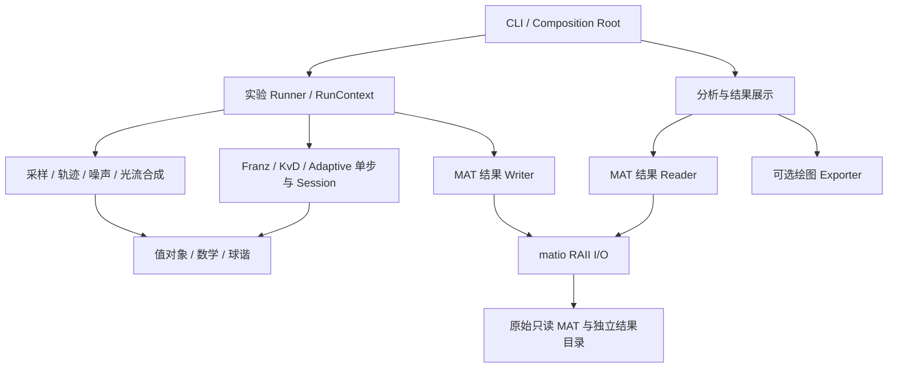
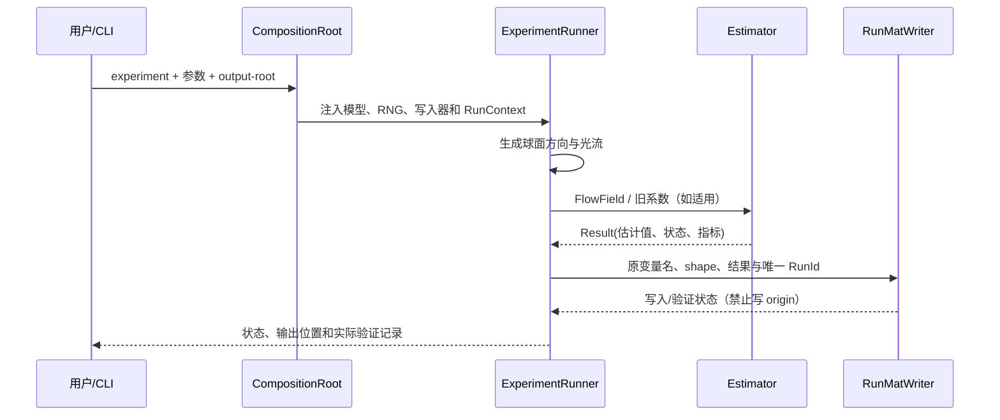
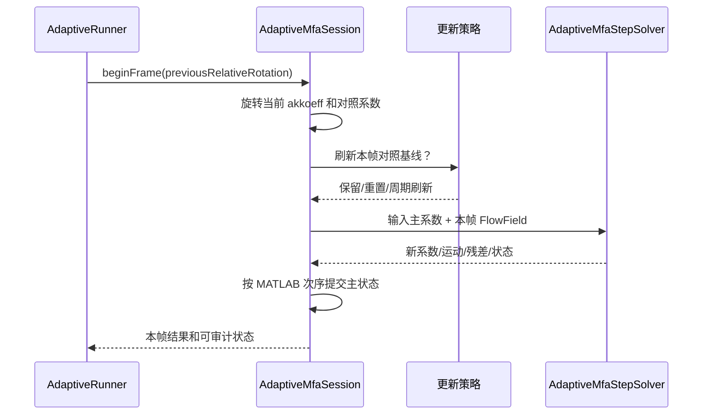

# 系统概要设计（HLD）— MATLAB 自运动估计 C++ 移植

> **状态：架构评审草案 v0.1，未冻结；无 C++ 实现与构建证据。** 来源是已核对的 MATLAB 源码和原 PLAN §3/4/6。需求依据见 [REQUIREMENTS.md](REQUIREMENTS.md)，类职责附件见 [OBJECT_MODEL.md](OBJECT_MODEL.md)，详细设计待定见 [design/README.md](design/README.md)，执行安排见 [PLAN.md](../PLAN.md)。以 [AGENTS.md](../AGENTS.md) 和项目所有者批准为准。

## 1. 架构目标、质量属性和约束

- C++17、Eigen 3、matio/zlib、CMake；**仅 Debian/Ubuntu**；原始 MATLAB/MAT 只读；不依赖 MATLAB Runtime、Python/NumPy/NPZ、ROS、OpenCV 或 Windows。
- 忠实保留三轴 Franz、Original/Modified KvD、Adaptive 单步、球谐旋转和五个实验数据生成入口的数学语义；观测为 N×6 三维球面光流而非图像或像素流。
- 数据生成、原始 MAT 访问、新 MAT 结果写入、数值分析和可选绘图应能分别调用。图形输出失败不得撤销已成功生成的计算结果。
- 模块之间通过明确输入输出和 C++17 值对象连接；只在资源或状态确有所有权含义时使用类。纯数学运算可用自由函数。
- 依赖方向不得从数学/领域求解器反向引用 CLI、matio 或绘图库。无全局隐式 RNG；原始 MAT 路径不得用作任何写出根目录。

## 2. 逻辑组件图

依赖的边界：
1. `origin/**` 是外部不可变输入；输出 `results/<RunId>/` 不允许覆盖已存在文件；执行前解析/检查路径是否与原始目录重叠。
2. 领域实体 `FlowField`、`MotionEstimate`、`HarmonicCoefficients` 自拥有值，不携带 matio 句柄或指向已释放缓冲区。
3. `AdaptiveMfaStepSolver` 是单步无状态计算，`AdaptiveMfaSession` 拥有跨帧 `akkoeff`；每种 baseline 的 `mitkoeff`/重置状态另行隔离。
4. `KvDIterationEngine` 可以共享计算流程，但不同平移更新规则必须可观察且不互换；不能硬造一个把 KvD 与 Adaptive 结果强行同构的“全能求解器”。
5. `IResultReader` 与 `IResultWriter` 是分别收窄的边界。C++ 运行器无权通过读接口修改原始数据。

## 3. 自原 PLAN 提取的模块和接口职责

### 模块、对象和数据契约（原 PLAN §3）

#### 3.1 必须分离的模块

- **mat_io**：原始 MAT 只读打开、压缩变量、类型/维度检查、变量名、MAT 结果独立写出；不依赖任何求解器或绘图。
- **core_types**：方向/光流集合 N×6 的语义访问、参数、随机种子、状态、误差和失败码；不直接持有 MATLAB 文件句柄。
- **math3d**：三维向量、叉积矩阵、Rodrigues 的实验实际使用子集；无实验状态。
- **sampling**：递归三角形、八面体、缺损八面体、二十面体；输出顺序固定。
- **flow_simulation**：正向光流、随机近度、球体内近度、两种明确的噪声模型；通过显式 RNG 注入。
- **estimators/standard_filter**：zellendefinieren + franzeigen；可独立测试。
- **estimators/kvd**：Original/Modified 共用公共运算但保留各自不同的平移更新和停止逻辑。
- **harmonics**：向量→球角、关联勒让德、实球谐、近度重构、逐项系数拟合、球谐旋转；无实验读取。
- **estimators/adaptive**：oneit_adaptiv_matched_filter 的单次迭代；输入旧系数和流场，输出新系数、t、ω、误差与有效性状态。
- **trajectory**：圆轨迹、正弦轨迹、轨迹差分与相机朝向、球内求交；无 MAT I/O。
- **experiments**：只负责原始参数组合、运行调度、状态更新、输出组织；不得重复实现数学公式。
- **analysis**：加载历史/新 MAT 结果、跨 40 运行汇总、数值曲线数据及指标；与图像绘制分离。
- **plotting**：2D、3D 图表导出。后期可评估 Debian/Ubuntu 可用的可选 gnuplot 后端，不将其变成数值核心的必需依赖，也不加入 Python。

#### 3.2 接口合同先于实现

- 统一规范 setofpoints 行结构为 direction (3) + tangent_flow (3)，明确 **N×6、列主序、右手系、坐标系、角速度符号**；独立的 Eigen 数据访问层对外可提供结构化读取，不必把 N×6 传染到所有模块。
- ExperimentConfig 以各原始入口的实参和实际常量为起点；**每个实验有独立默认值**，共享的只是明确有物理意义的可复用字段。若使用配置模板，遵守 AGENTS.md 对 configs/README.md 的要求。
- RNG 由实验运行器显式创建并传入模拟器。原程序使用 RandStream mt19937ar 和 rand/randn；现代 C++ 同 seed 不保证 randn 样本逐项一致。因此定义：固定输入数值对照与随机分布/统计复现分别验收；不得虚报同种子逐位相等。
- 核心数值 API 返回明确结果/状态，不把 NaN、Inf、零范数或奇异矩阵结果偷偷替换成 0 或伪造成功。原版失败行为需与后续安全防护区分记录。
- 实验输出采用新结果根目录和 RunId；原始 origin/** 永远只读。当前 MATLAB 的 save 输出 **一个变量一个 MAT 文件**，首版兼容输出应优先保留变量名、矩阵形状和路径约定；已存历史文件不允许被重新生成结果覆盖。
- 读取或写入 MAT 的图表程序不得改变任何求解结果；绘图不可用时数值实验和 MAT 回归仍能独立完成。

#### 3.3 面向对象设计的基本原则（由实际 MATLAB 调用关系确定）

**本项目采用面向对象为主、无状态数学函数为辅的现代 C++17 设计。** 现有模块划分只说明职责分组，并不能自动保证面向对象；实施前必须明确封装边界、对象状态、资源所有权、依赖方向以及允许扩展的接口。

1. **单一职责（SRP）**：MAT 访问、物理模拟、数值求解、轨迹状态更新、结果分析和绘图不得由同一个类实现。
2. **组合优先**：仅当运行器确实需要替换采样器、噪声模型、随机源或更新规则时引入抽象接口；叉积、点积、球谐单点求值等无状态数学操作允许保留命名空间中的普通函数。不要为了 OOP 而机械地为每个 MATLAB 函数创建一个类或一个虚函数。
3. **依赖倒置（DIP）**：实验运行器仅依赖领域数据、轻量接口及明确的求解器对象，不依赖 matio 原始指针、图表库或 CLI 全局变量。具体依赖在应用入口集中构造并注入。
4. **开放封闭（OCP）**：新增另一种采样或噪声模型应通过新的实现接入，不要求改动已验证的原始算法公式。原始/修正 KvD 必须有可辨认的数学更新策略。
5. **接口隔离（ISP）**：MAT 只读接口不得出现写入方法；单次 Adaptive MFA 求解器不得被强行塞入要求 KvD 近度迭代输出的通用基类。
6. **值语义优先**：方向、流场、运动估计、球谐系数、实验参数和指标使用可复制/移动的结构化值对象，保留数学含义和维度；不因泛化而隐去固定 3D、3×5、6×6 约束。
7. **无全局可变状态**：随机数发生器、算法历史、系数更新间隔和输出目录均由一次 RunContext / Session 明确拥有；不得使用隐式单例、进程全局 RNG 或跨实验复用的可变缓存。
8. **忠实行为高于复用率**：抽取共享代码只能合并数学上确实相同的步骤；如果类抽象会掩盖 MATLAB 原版不同的更新次序、误差定义或输出合同，则保留独立实现。

#### 3.4 对象模型与原 MATLAB 函数映射

以下名称是**拟设计的 C++ 类或值类型**，尚未创建；接口细节需在 P0 调用关系与数据形状审计后固定。类型和方法名称只代表职责，不要求必须逐字采用。

| 类/接口/值对象 | 必须封装的状态或职责 | MATLAB 来源与直接依赖 |
|---|---|---|
| **FlowField**（值对象） | 拥有 N×6 列主序流场；提供只读方向、切向光流访问及形状校验；不持有文件句柄 | 各脚本的 setofpoints；Eigen |
| **MotionEstimate**、**SolverResult**（值对象） | 分别表示 t、ω、近度/迭代数和有限性/退化/失败状态；不借用临时数据 | KvD、franzeigen、oneit 的输出 |
| **HarmonicCoefficients**（值对象） | 精确保留 3×5 存储及 1+3+5 有效位置；记录零阶项与 8 个非零阶参数的区别 | altkoeff、neukoeff、akkoeff、mitkoeff |
| **MatFileHandle**、**MatVariableHandle**（RAII） | move-only；分别拥有 mat_t*、matvar_t*；禁止复制与越期借用；只读句柄不可转换成写句柄 | matio C API；禁止泄漏到领域层 |
| **MatResultReader** / **RunMatWriter** | 前者只读原始及结果 MAT，支持按变量名读取与 getflowfield 兼容模式；后者只能写入明确的独立结果根目录 | getflowfield、load、save；由 RAII 提供访问 |
| **IResultReader** / **IResultWriter**（窄接口） | 为实验/分析层提供按业务含义读取或写入数据的契约；测试可替换成内存存储 | MatResultReader、RunMatWriter；不暴露 matio |
| **IRandomSource**（接口） | 产生 uniform / normal 样本；每次实验持有独立 RNG；支持固定序列测试替身 | RandStream、rand、randn；具体实现为 Mt19937RandomSource、FixedSequenceRandomSource |
| **IDirectionSampler**（接口） | 按指定细分级别返回视线集合；实现 OctahedralSampler、OccludedOctahedralSampler、IcosahedralSampler | findeDreiecke 与三个入口采样函数 |
| **IFlowNoiseModel**（接口） | 只负责从原始流场和随机源生成加噪流场；实现 MeanMagnitudeGaussianNoise、ComponentGaussianNoise、NoNoise | fixed_kugel...、fixed_propfehler...、nonpropfehler |
| **FlowSynthesizer** | 合成平移/旋转切向光流及其平均模长；无跨帧状态 | erzeugeflussausnear；sampling、math3d |
| **SphereEnvironment** | 单位球体内射线相交与近度计算；不管理轨迹状态 | getnear_in_kugel_Drehung |
| **FranzMatchedFilter** | 执行三轴平移/旋转模板响应及原版归一化，返回明确运动估计值；无历史状态 | zellendefinieren、franzeigen |
| **KvDIterationEngine** | 封装共享的初始化、近度重估、残差、旋转更新和停止逻辑，保留每次更新的顺序 | norm_koenderink_iteration、mue_norm_koenderink_iteration |
| **IKvDTranslationRule**（内部策略）及 **OriginalKvDEstimator**、**ModifiedKvDEstimator** | 两种不同的平移更新法则与明确命名的求解器入口；不通过容易误设的布尔参数悄悄切换算法 | KvD 原始与修正方程；共享 KvDIterationEngine |
| **RealSphericalHarmonics**、**HarmonicFitter**、**HarmonicRotator** | 分别负责基函数/近度重建、逐项拟合、l≤2 旋转；不持有实验历史状态 | kugelflfunc2、near_aus_koeff、koeff_aus_near、SHRotate、transfor_koeff |
| **AdaptiveMfaStepSolver** | **无状态单轮计算**：从旧系数和 N×6 流场构造 6×6 系统并返回运动、残差、新系数；不继承 KvD | oneit_adaptiv_matched_filter |
| **AdaptiveMfaSession** | 拥有一次轨迹运行中的当前 akkoeff；执行“上一帧旋转→本帧求解→提交后验系数”的确定时序 | adaptive 三种 data_generation 入口 |
| **ICoefficientUpdatePolicy**（接口） | 维护只与基线对比相关的更新规则：每帧重置、每帧继承、按 1/5/11/21 帧刷新；不能偷改真正的 akkoeff 主状态 | ohnekoeff、mitkoeff、zeitkonstanten |
| **TrajectoryGenerator**、**TrajectoryKinematics** | 分别生成圆/正弦点序列，以及绝对/相对旋转和局部平移；不用加载 MAT | kreis_trajektorie、sinuskurve_trajektorie、trajektorie_aus_punkten |
| **BiasExperimentRunner**、**InitializationRunner**、**AdaptiveComparisonRunner**、**UpdateRateRunner** | **每个入口一个编排对象**；只组合模拟、估计、误差、保存服务，不重复具体算法方程 | 五个 MATLAB data_generation 入口；Bias 的两种模式共享 Runner + 明确配置 |
| **BiasResultAnalyzer**、**AdaptiveResultAnalyzer** | 读取结果、统计 40 个偏差运行和三类自适应轨迹结果；输出可绘制的数值序列 | 四个 data_analysis 脚本 |
| **IPlotExporter**（可选接口） | 仅接收分析后的绘图数据；不允许修改数值结果，不作为核心程序运行依赖 | graphs_*.m 与 illustrations/ |
| **CommandDispatcher** / **ApplicationCompositionRoot** | CLI 解析、选择实验配置、建立对象依赖图；不持有算法公式、不把路径或原始 C 指针传入求解器 | 新项目的 C++ 应用入口 |

**重要说明**：I 开头的接口只用于确有替换需求的依赖边界。对简单数学运算，应使用普通函数而不是建立继承体系；具体不变量和返回值规范需在实现子任务中确定，不应提前创建大而全的基类。

#### 3.5 所有权、生命周期、错误与依赖注入合同

| 运行实体 | 谁创建和拥有 | 生命周期及不可违反的规则 |
|---|---|---|
| 原始 MATLAB 目录 | 外部只读仓库数据，非 C++ 对象所有 | 原路径和原文件必须保持不变；不得通过其他输出路径、软链接或相对路径逃逸覆盖 |
| MatFileHandle / MatVariableHandle | I/O 层局部对象 | 作用域结束立即释放；不得在返回给算法层的 Eigen 引用中保留已失效的内存 |
| FlowField、MotionEstimate、HarmonicCoefficients | 由业务对象按值拥有 | 输出对象可在句柄销毁后独立存在；维度、坐标和存储顺序在构造时验证 |
| IRandomSource 具体对象 | 每个实验运行的 RunContext | 只在本 RunId 内被消费；严格保留原版 rand/randn 调用先后次序；多运行/多线程不能共享隐式可变 RNG |
| Estimator / StepSolver | 实验编排对象通过构造注入或组合持有 | 数学求解器尽量无状态；共享只读参数；不保存上一帧会话状态 |
| AdaptiveMfaSession / 更新策略 | 一个轨迹实例一个会话 | 负责前一帧旋转、主系数状态、对比基线的独立系数、刷新时刻和当前帧结果提交 |
| RunMatWriter / 结果目录 | 每个 RunContext 独占 | 输出位置在写入前确认不属于 origin/**；默认拒绝覆盖已有实验结果；失败日志独立保存 |
| Analyzer / PlotExporter | 由相应分析命令创建 | 只消费数值结果；生成图表失败不得导致已经计算的结果丢失 |

- **依赖方向**：CLI/实验运行器 → 领域值对象 + 窄接口 → 数学/求解器；MAT、绘图等第三方组件只在基础设施实现层出现；领域层与求解器不得 import/include matio。
- **结果类型**：业务错误按类别明确返回（MAT 格式不符、找不到变量、维度错误、零范数、近度归一化失败、病态系统、非有限值、无效角度）；可用兼容 C++17 的显式结果值/错误对象，不把数值失败当作正常 0。保留 MATLAB 原版原始行为的证据，安全边界处理单独标注，不暗改基准结果。
- **不制造通用求解器假象**：Franz 基线、KvD 完整迭代、Adaptive 单步的输入与输出不完全相同；可以共享 FlowField、MotionEstimate 等值对象，但不强制通过一个会丢失 near、coeff 或迭代状态的统一基类。
- **构造时注入**：BiasExperimentRunner 由采样器、NoiseModel、Franz/KvD 求解器、随机源和结果写入器组成；Adaptive Runner 由轨迹、SphereEnvironment、采样器、StepSolver、状态会话、噪声策略和结果写入器组成。运行器不根据字符串自行 new 具体类型，具体选择集中在 ApplicationCompositionRoot。
- **迭代和状态更新的顺序**：KvDIterationEngine 的每步残差/停止检查遵循 MATLAB 的原始顺序；AdaptiveMfaSession 在 i 帧首先旋转上一帧系数，再为各个基线按策略更新，然后分别调用无状态单步求解，最后更新主 akkoeff。策略不得越权修改主状态。
- **测试替身**：纯算法和模拟器测试可以注入 FixedSequenceRandomSource、固定采样器、内存结果读写器；不依赖真实 MAT 文件；MAT 读写集成测试则必须使用原始归档或专门的测试 MAT 并明确测试范围。

#### 3.6 面向对象设计验收门槛

在开始大量移植函数之前，P0 应形成可审核的类职责表、接口/数据合同、对象生命周期表和依赖图。满足以下全部条件才可声称 OOP 设计落地：

1. 每个有状态对象有唯一明确的写入所有者；原始 MAT 的读写隔离由对象权限保证，而不是仅靠约定。
2. 每个 MATLAB 函数能够映射到确定的 C++ 类方法或无状态数学函数；不是“某个模块迟早会实现”。
3. 原始/修正 KvD 各有显式的对外入口，共享引擎不会使两种方程混淆。
4. Adaptive 单步求解可以不构造 Session 就独立验证；Session、刷新策略和主状态的组合可独立测试。
5. 实验运行器可注入固定随机序列、方向集合、结果存储替身而不修改算法代码。
6. CLI、matio、绘图、随机实现不能反向依赖求解器内部；数学层不依赖 I/O。
7. 不为每个 MATLAB 函数机械创建独立对象，也不把整个项目包装成一个巨型 Egomotion 类；设计以真实职责和生命周期为准。
8. 只有文档完成不能算作 OOP 功能已实现，须在后续任务中通过头文件/实现、独立测试和实际集成证明。

> 本节列的是**拟议接口与类职责**，不是现有头文件。单个接口的精确签名、错误码和布局应在 P0.7/P0.8 经审阅后进入详细设计；不得在未核验 MAT 变量和第三方版权的条件下声称已经冻结。

## 4. 建议文件与库边界

### 目录与工程模块（原 PLAN §4）

下列为**计划**，目前尚未创建。避免再复制一套 data/original/：已有原始文件以 origin/egomotion_estimation_dense_flow_fields_matlab_scripts/ 为唯一来源。生成结果应位于受保护的独立运行目录。

~~~text
Egomotion-Estimation-with-Dense-Flow-Fields/
├── AGENTS.md
├── PLAN.md
├── README.md
├── .gitignore
├── CMakeLists.txt
├── CMakePresets.json
├── origin/egomotion_estimation_dense_flow_fields_matlab_scripts/  # 原样保留、只读
├── include/egomotion/
│   ├── domain/
│   │   ├── flow_field.hpp          # FlowField 值对象
│   │   ├── motion_estimate.hpp     # MotionEstimate / SolverResult
│   │   ├── harmonic_coefficients.hpp
│   │   └── experiment_config.hpp
│   ├── contracts/                # 仅有替换需求的窄抽象接口
│   │   ├── random_source.hpp
│   │   ├── direction_sampler.hpp
│   │   ├── flow_noise_model.hpp
│   │   ├── result_reader.hpp
│   │   ├── result_writer.hpp
│   │   └── coefficient_update_policy.hpp
│   ├── io/
│   │   ├── mat_file_handle.hpp    # move-only RAII
│   │   ├── mat_result_reader.hpp
│   │   └── run_mat_writer.hpp
│   ├── math/
│   │   ├── vector_ops.hpp        # 无状态数学函数
│   │   └── rotations.hpp
│   ├── geometry/
│   │   ├── direction_samplers.hpp
│   │   └── flow_synthesizer.hpp
│   ├── simulation/
│   │   ├── random_sources.hpp
│   │   ├── noise_models.hpp
│   │   ├── sphere_environment.hpp
│   │   └── trajectory.hpp
│   ├── estimators/
│   │   ├── franz_matched_filter.hpp
│   │   ├── kvd_iteration_engine.hpp
│   │   ├── kvd_translation_rules.hpp
│   │   ├── kvd_estimators.hpp
│   │   ├── adaptive_mfa_step_solver.hpp
│   │   └── adaptive_mfa_session.hpp
│   ├── harmonics/
│   │   ├── real_spherical_harmonics.hpp
│   │   ├── harmonic_fitter.hpp
│   │   └── harmonic_rotator.hpp
│   ├── experiments/
│   │   ├── run_context.hpp
│   │   ├── bias_experiment_runner.hpp
│   │   ├── initialization_runner.hpp
│   │   ├── adaptive_comparison_runner.hpp
│   │   └── update_rate_runner.hpp
│   └── analysis/
│       ├── metrics.hpp
│       ├── bias_result_analyzer.hpp
│       └── adaptive_result_analyzer.hpp
├── src/                          # 与 include 中的职责对应；实现不得反向依赖 CLI
│   ├── domain/
│   ├── io/
│   ├── math/
│   ├── geometry/
│   ├── simulation/
│   ├── estimators/
│   ├── harmonics/
│   ├── experiments/
│   ├── analysis/
│   ├── plotting/                 # 可选后端，后期启用
│   └── cli/
│       ├── composition_root.cpp  # 唯一应用装配位置
│       └── main.cpp
├── tests/
│   ├── unit/                     # 值对象、数学、策略、单步求解
│   ├── contracts/                # RNG、MAT、读写与接口替身
│   ├── golden/                   # 原始 MAT 只读对照
│   ├── integration/              # 运行器、状态会话和 MAT 闭环
│   └── reproduction/             # 原论文统计与图表数据
├── docs/
│   ├── SOURCE_INVENTORY.md
│   ├── MAT_DATA_SCHEMA.md
│   ├── MIGRATION_MATRIX.md
│   ├── OBJECT_MODEL.md          # 类职责、组合、依赖和所有权
│   ├── NUMERICAL_EQUIVALENCE.md
│   └── PROGRESS.md
└── results/                      # 独立 RunId 输出，不得覆盖 origin
~~~

建议一个主 CLI（例如 egomotion）由 ApplicationCompositionRoot 组装对象，通过 CommandDispatcher 提供 **inspect-mat、run-bias-occluded、run-bias-proportional、run-adaptive-init、run-adaptive-comparison、run-adaptive-update-rates、analyze、plot** 等子命令；实验数值计算与分析/绘图可以分别执行。子命令是规划中的接口名，不代表已实现。结果路径必须可配置，不能依赖执行时的当前工作目录。

### 4.1 拟议 CMake target 拆分（未建立）

| Target（工作名） | 类型与职责 | 链接的内部依赖 | 不允许依赖 |
|---|---|---|---|
| `egomotion_domain` | 数值值对象、数学、采样、球谐、核心算法 | Eigen；无 I/O | matio、CLI、绘图 |
| `egomotion_simulation` | 噪声、轨迹、光流场景 | domain | matio、plotting |
| `egomotion_matio` | MAT RAII、读取、结果写入与字典工具 | domain 的必要数据合同、matio/zlib | estimator 实现与绘图 |
| `egomotion_experiments` | 五类原入口编排及 RunContext | domain、simulation、I/O 窄接口 | 直接调用 matio C API |
| `egomotion_analysis` | Bias/Adaptive 已有 MAT 的数据统计 | domain、I/O 窄接口 | solver 内部与绘图库 |
| `egomotion_plotting` | 后期可选图表输出 | analysis | 反向控制 core |
| `egomotion` | CLI、参数解析、对象装配 | 其他需要的 target | 自身实现算法公式 |
| `egomotion_tests` | 单元/合同/金标准/集成与论文验证 | 被测 target | 未授权的真实数据写入 |

target 名称/共享静态库安排仍为设计候选，需根据循环依赖检查和 Debian/Ubuntu 打包能力调整；所有依赖应明确声明，不新增仅“可能用到”的库。

## 5. 关键数据流与运行时序

### 5.1 MAT 文件读取与单轮实验

### 5.2 Adaptive Session 跨帧行为

说明：实际 MATLAB 脚本在进行主状态 `akkoeff` 更新之前会分别对照 baseline 求解；设计时必须保留该先后关系。只有单步成功与失败行为经过源码/数值核对后，才能确定 Session 的异常状态转移与提交规则。

### 5.3 错误/状态流

结果至少区分输入验证、MAT 解码/形状、输出覆盖保护、数值退化（零范数、奇异系统、非有限值）、可选绘图缺失及实验部分完成。错误应携带调用阶段、源/目标变量、RunId 和上下文，不把 NaN/Inf 当作通过。具体枚举与 CLI 退出码须在 LLD + SRS 验收条款冻结。

## 6. 既有计划的实施依赖和并行边界

### P0–P10 依赖图（原 PLAN §6）

~~~mermaid
flowchart TD
  P0[P0 源码、对象模型与合同审计] --> P1[P1 RAII MAT I/O、CLI 与装配]
  P0 --> P2[P2 数学与采样]
  P1 --> P5[P5 Bias 实验]
  P2 --> P3[P3 FlowSynthesizer 与噪声策略]
  P2 --> P4[P4 Franz 与 KvD 策略引擎]
  P3 --> P5
  P4 --> P5
  P2 --> P6[P6 轨迹与旋转]
  P2 --> P7[P7 球谐与无状态 Adaptive 单步]
  P6 --> P7
  P3 --> P8[P8 Adaptive 实验]
  P6 --> P8
  P7 --> P8
  P1 --> P8
  P5 --> P9[P9 数据分析与绘图]
  P8 --> P9
  P1 --> P9
  P9 --> P10[P10 全量核验与交付]
~~~

- P0 对象模型和窄接口合约先冻结；P1 MAT I/O、P2 纯数学、P6 轨迹和 P7 球谐基函数准备可在满足依赖后分派到不同**独立工作区/任务分支**，但同一文件与工作区不能由多个 Agent 并发写。P7 的球谐旋转功能依赖 P6 的旋转数学接口；**Adaptive 单步求解不依赖 KvD 的 C++ 实现**，不要因论文中的理论关系而人为耦合 P4 与 P7。
- 每个子任务应是小范围、可验证、独立提交；不得因“同时开发更快”而先把未验证的共享 API 任意修改。变更共同类型或坐标合同先由集成负责人核对。
- 每次编译、运行或实验前，先按 AGENTS.md 完成允许的代码提交/推送远程检查点。不得等待 GitHub Actions。
- **本轮仅修订 PLAN.md；P0～P10 的任何 C++ 文件、构建、CTest、随机仿真和分析程序均尚未实施。**

## 7. 架构决策记录（ADR 草案）

| ADR | 决策 | 理由 | 状态 |
|---|---|---|---|
| ADR-001 | 原始 `.mat` 只读；`matio+zlib` 为唯一读取路径 | 保留作者数据并使用压缩 MAT v5；HDF5 按全量审计决定 | 已由用户定方向，格式边界待审计 |
| ADR-002 | C++17/Eigen/CMake；仅 Debian/Ubuntu | 与 [AGENTS.md](../AGENTS.md) 一致 | 已确认 |
| ADR-003 | 组合优先、少量窄接口、纯数学保留函数 | 避免为每个 MATLAB .m 制造类层次 | 设计草案，未冻结 |
| ADR-004 | Adaptive 单步求解与跨帧 Session 分离 | 固定单步回归、隔离不同频率状态 | 设计草案，未冻结 |
| ADR-005 | MAT 结果与绘图解耦 | 无图形下先保证数据数值一致 | 已确认方向，后端待选 |
| ADR-006 | 不复制 rodrigues/SHRotate 第三方代码直至权利核验 | 文件头表明有其他作者来源 | 版权待核 |
| ADR-007 | 原 MATLAB 行为优先；偏离行为要单独标注 | 忠实移植和数值回归为首要目标 | 已确认 |

## 8. HLD 评审冻结清单

- [ ] 原始 45 个 .m → 模块/对象/无状态函数映射可追踪；MAT 数据字典和 582 个样本版本完成审计。
- [ ] 每个公共领域值对象、误差类型、抽象接口有明确约束、方向、所有权和必要的不变量。
- [ ] CLI 参数 schema、错误码、RunId 与输出不可覆盖合同被批准。
- [ ] CMake target 依赖图没有环，模块公共/私有头文件边界被批准。
- [ ] Adaptive Session 的时序和重置策略以原函数调用顺序交叉核对。
- [ ] 球谐基函数/旋转约定、数值容差与黄金测试数据来源有证据。
- [ ] 第三方版权、性能指标的未决事项明确列出阻塞状态和批准人。
- [ ] 确认源外构建、平台要求与 [AGENTS.md](../AGENTS.md) 无冲突。

**当前 HLD 仍为草案；不因创建本文件而通过任一检查项。**
