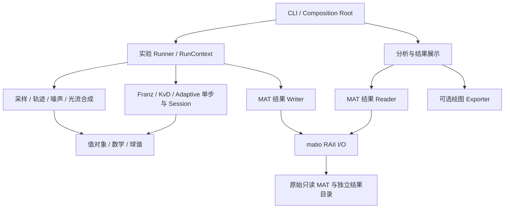
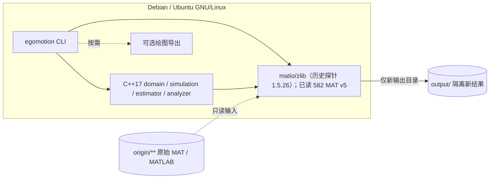
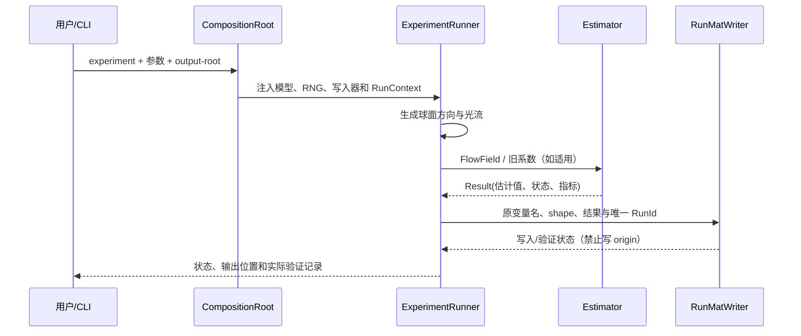
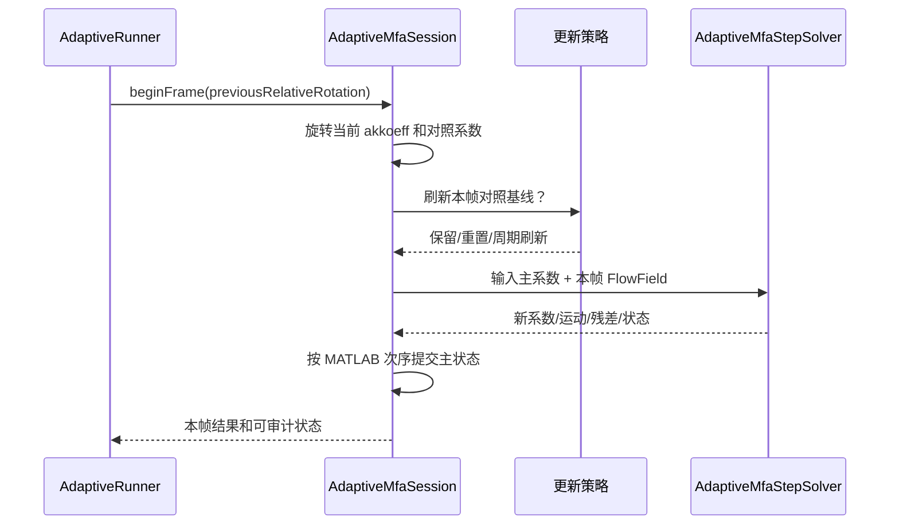

# 系统概要设计（HLD）— MATLAB 自运动估计 C++ 移植

> **状态：架构评审草案 v0.4，未冻结；已有独立 C++ matio 探针的实测证据，尚无业务模块、完整 CMake target 及 CTest 构建证据。** 来源是已核对的 MATLAB 源码和原 PLAN §3/4/6。需求依据见 [REQUIREMENTS.md](REQUIREMENTS.md)，类职责附件见 [OBJECT_MODEL.md](OBJECT_MODEL.md)，详细设计待定见 [design/README.md](design/README.md)，执行安排见 [PLAN.md](PLAN.md)。以 [AGENTS.md](../AGENTS.md) 和项目所有者批准为准。

## 1. 架构目标、质量属性和约束

**长期证据边界**：[无需 MATLAB 执行政策](golden/NO_MATLAB_EXECUTION_POLICY.md) 已取消 MATLAB/Octave 及 L1 逐节点 Golden 的冻结前置条件。HLD 部署视图不得引入 MATLAB Runtime，质量场景可采用 L2 最终 MAT、L3 独立逐节点参考及 L4 统计；无 L1 仅限制声称原版运行行为完整等价，**不是架构阻塞**。真实 CMake/CTest、版权、接口与指标审批门禁保持。

- C++17、Eigen 3、matio/zlib、CMake；**仅 Debian/Ubuntu**；原始 MATLAB/MAT 只读；不依赖 MATLAB Runtime、Python/NumPy/NPZ、ROS、OpenCV 或 Windows。
- 忠实保留三轴 Franz、Original/Modified KvD、Adaptive 单步、球谐旋转和五个实验数据生成入口的数学语义；观测为 N×6 三维球面光流而非图像或像素流。
- 数据生成、原始 MAT 访问、新 MAT 结果写入、数值分析和可选绘图应能分别调用。图形输出失败不得撤销已成功生成的计算结果。
- 模块之间通过明确输入输出和 C++17 值对象连接；只在资源或状态确有所有权含义时使用类。纯数学运算可用自由函数。
- 依赖方向不得从数学/领域求解器反向引用 CLI、matio 或绘图库。无全局隐式 RNG；原始 MAT 路径不得用作任何写出根目录。

## 2. 逻辑组件图

依赖的边界：
1. `origin/**` 是外部不可变输入；输出 `output/<RunId>/` 不允许覆盖已存在文件；执行前解析/检查路径是否与原始目录重叠。
2. 领域实体 `FlowField`、`MotionEstimate`、`HarmonicCoefficients` 自拥有值，不携带 matio 句柄或指向已释放缓冲区。
3. `AdaptiveMfaStepSolver` 是单步无状态计算，`AdaptiveMfaSession` 拥有跨帧 `akkoeff`；每种 baseline 的 `mitkoeff`/重置状态另行隔离。
4. `KvDIterationEngine` 可以共享计算流程，但不同平移更新规则必须可观察且不互换；不能硬造一个把 KvD 与 Adaptive 结果强行同构的“全能求解器”。
5. `IResultReader` 与 `IResultWriter` 是分别收窄的边界。C++ 运行器无权通过读接口修改原始数据。

### 2.1 部署视图（仅 Debian/Ubuntu，设计草案）

- 运行进程仅在 Debian/Ubuntu 构建；MAT 文件由本地文件系统提供，不要求网络或 MATLAB/Python 服务。
- 原始输入目录的文件句柄只读、哈希不变；写入器不得通过软链接或路径穿越覆盖 origin。
- 只有 `inspect-mat`、实验生成、数据分析是数值主路径；图形服务可缺失，不影响无界面运行。
**H-04 环境事实与预算/验收门槛分栏（均非本轮现场实测）**：

| 项目 | 用户提供或历史记录的事实 | 项目预算/验收状态 |
|---|---|---|
| 目标系统 | 用户 `uname -a`：Ubuntu 24.04.4 VirtualBox、x86_64 | 已作为目标环境快照；不是业务构建通过或 Debian 兼容性证据 |
| RAM/Swap | 用户 `free`：物理内存总 `8127380` KiB，当时 available `4908696` KiB，Swap 总 `4194300` KiB | **不是**批准的峰值 RSS、并发量、线程数或性能上限 |
| 磁盘 | 用户 `df`：根分区当时可用 `65347856` KiB | **不是**批准的构建/输出/测试磁盘配额 |
| 编译工具与依赖 | 历史独立 MAT 探针：GCC 13、matio 1.5.26；该用户快照无新的 Sophus/Eigen/CMake 版本证据 | 生产目标尚未实际构建/链接；支持版本范围仍待核准 |
| wall / CPU / RSS / 构建时间 | 本次审批未提供业务程序测量值 | **无已批准性能预算或通过/失败阈值**；DEC-006 仍开放 |

表中 `uname/df/free` 来源为用户审批 JSON；探针版本属于**早前独立记录**，两者不能混成同一次运行证据。完整平台与性能核验仍以 [TEST_PLAN.md §6–7](TEST_PLAN.md) 的未来执行记录为准。

### 2.2 已实测的 MAT 数据合同

| 来源范围 | matio 实际读取结果 | 架构影响 |
|---|---|---|
| 全部 582 MAT | MAT v5/zlib、class=double/data_type=double、582 个变量 READ_OK | 当前真实归档只需 v5 + zlib 的 double 数值读取；其他 class 保留明确拒绝路径 |
| Bias 560 文件 | xwerte：80 个 10×1；ywerte1…6：480 个 10×3 | 使用真实 MAT rank/dims，不依据注释推测 |
| Adaptive 22 文件 | 35×1：4、600×1：14、600×4：4 | 当前历史结果结构已明确，**独立 L3 逐节点参考尚未完整建立**；不需要原 MATLAB L1 |
| 文件身份 | 每份文件一个与 basename 同名的变量；FNV-1a64 指纹 | 原始输入只读；FNV 不是 SHA-256 |

独立数据字典探针已经实测，但生产 `egomotion_matio` target、Reader/Writer 注入、错误负例、索引转换与写回读尚未验证。

## 3. 架构组件接口与职责（单一来源）

本节只定义**组件级**边界。具体类、值对象、所有权、状态机和 MATLAB 函数映射由 [OBJECT_MODEL.md](OBJECT_MODEL.md) 统一维护；精确函数签名、算法公式和错误枚举由 [design/](design/README.md) 的模块详细设计承担。不得把 HLD 中的“接口名称”误认为已经编译的 C++17 头文件。

| 组件 | 对外提供的能力 | 所需依赖 | 主要数据合同 | 错误边界 |
|---|---|---|---|---|
| domain/math | N×6 FlowField 和 3D 数学、运动估计值 | Eigen | 三维向量、列主序、坐标与单位 | 无效维度、零范数与非有限输入 |
| sampling | 八面体、缺损八面体、二十面体方向采样及注入 RNG 的 getvektor | domain/math、**contracts**（IDirectionSampler/IRandomSource） | 顺序确定的 N×3 单位视线 | 非法细分级别、数目溢出、随机源错误 |
| simulation | 球内近度、光流合成、随机噪声、轨迹（H-02 的旋转向量→矩阵采用 Sophus） | domain/math、sampling、**contracts**（IRandomSource/IFlowNoiseModel）；**Sophus 作为规划的私有外部依赖** | 近度、t、ω、三维切向光流 | 无效几何、随机源异常 |
| harmonics | 实球谐基函数、近度拟合/重建、系数旋转（H-14 的 Don Williamson 方案 A） | domain/math；**受控的第三方 Ivanic–Ruedenberg C++ 源码适配层作为私有实现** | l≤2、3×5 以及 3×3/5×5 旋转块 | 系数形状、归一化与旋转失败 |
| estimators | Franz、Original/Modified KvD、Adaptive 单步估计 | domain/math、harmonics（Adaptive） | FlowField、近度/系数、运动估计与计算状态 | 退化、奇异系统、非有限值 |
| mat_io | 原始 MAT 只读元数据/变量读取与新 MAT 输出；实现 IResultReader/IResultWriter | matio/zlib、domain 值类型、**contracts** | rank、dims、class、dtype、列主序、变量名 | 文件/解压/类型错误、路径拒绝 |
| experiments | 五类 MATLAB 原实验的参数编排、独立 RunId 与状态 | domain、**contracts**（写入窄接口）、**sampling**、simulation、estimators | 参数、seed、结果 MAT、有效/失败样本数 | 缺配置、数值失败、输出冲突 |
| analysis | 四类 MATLAB 结果分析的数据统计与曲线序列 | domain、**contracts**（IResultReader；不直接链接 matio） | xwerte/ywerte、Adaptive 错误序列、曲线索引 | 缺变量、shape 冲突、无定义统计 |
| plotting（可选） | 统计结果的 2D/3D 可视化 | analysis | 绘图数组、单位、图例与区间 | 后端缺失；不得修改原始数值 |
| cli/composition | 命令、参数检查、状态/退出码和对象装配 | experiments、analysis、mat_io、**contracts**；plotting 可选 | 只读输入路径、独立输出根 | 参数、源/输出冲突、执行失败 |

**组件依赖一致性**：本节内部项目模块依赖集合与 §4 target 表、§4.1 的 27 条直接 DAG 边一一对照；**新增 Sophus 与未来第三方 SHRotation 为外部/私有实现依赖，暂不作为新增内部 egomotion_ target 边计数**；本次是**文档合同**，尚不能等同真实 CMake target 的编译/链接。实际 C++ 实现可能需要修改依赖时，须同时维护三处与 ADR-008。

**边界不变量**：求解器不 include matio 或绘图库；I/O 不持有求解器；实验 Runner 不重复数学公式；分析/绘图不修改求解结果。实验参数按 MATLAB 的五个入口分别定义，禁止以一个未经核准的全局默认值覆盖其差异。

### 3.1 接口合同与设计冻结状态

- 外部可观察合同以 [REQUIREMENTS.md](REQUIREMENTS.md) 中 REQ-I-* 与 [TEST_PLAN.md](TEST_PLAN.md) 的 TC 为准；内部设计原则单独归入 REQ-DC-*，不将 RAII/继承选择误写成 CLI 用户需求。
- 尚未确定的 C++17 方法签名、返回错误类型、固定矩阵布局、线程安全边界和 ABI 由 P0.7/P0.8 评审后在 LLD 逐模块冻结。CLI 选项、退出码与错误诊断的可评审候选已单列于 [design/cli.md](design/cli.md)，仍需批准并取得实际代码/CTest 证据。
- `IResultReader` / `IResultWriter` 在 `egomotion_contracts` 中分别声明，`egomotion_matio` 的具体实现由 Composition Root 注入实验/分析。原始文件只读保障还必须体现在路径校验与不可覆盖测试中。跨层用自拥有值对象，MAT 缓冲区失效后不得持有 Eigen Map。
- 对 KvD 两条平移更新保留独立入口；Adaptive 的单步求解与多帧 Session 独立。**这些是已选设计方向，并非已验证实现**。

**最新所有者决定**：[2026-11-07 决策记录](decisions/PROJECT_OWNER_DECISIONS_2026-11-07.md) 与 [Ivanic–Ruedenberg 原始文献/Eigen LLD](design/SH_ROTATION_IVANIC_RUEDENBERG.md) 已确定 `egomotion_harmonics→egomotion_contracts` 的显式依赖（DAG 从 26 增至 27 条边）以及**禁用 sdla**。每次运行的输出根固定为 `output/<RunId>/`，不接受 CLI 自定义输出目录；项目新代码使用根 MIT [LICENSE](../LICENSE)。普通版权审查不再作为开发前置门禁，实际引入第三方文件保留其既有许可告知。球谐递推生产实现须等用户上传 1996 原文及 1998 勘误后开始。

## 4. CMake target、公共头文件与文件结构（设计候选）

本 HLD 负责给出**无环依赖的库边界**；工程目录概览见 [PLAN.md](PLAN.md) §4，具体对象与 MATLAB 函数的映射由 [OBJECT_MODEL.md](OBJECT_MODEL.md) 统一维护，模块内部合同见 [design/](design/README.md)。正式 include/src 路径应在 P0.8 冻结；以下 target 名称不表示仓库已经创建对应库。

| 拟议 target | 公开边界 | 依赖 | 私有实现/禁止逆向依赖 |
|---|---|---|---|
| egomotion_domain | domain 值类型、向量/旋转及基本数学函数头 | Eigen 3 | 不引入 matio、experiment、CLI |
| egomotion_contracts（INTERFACE 候选） | IResultReader/IResultWriter、IRandomSource 等只声明领域依赖的窄接口 | domain | 不含 matio.h、不链接 I/O 实现、不提供 C 函数入口 |
| egomotion_sampling | 方向采样接口及实现、注入 RNG 的随机球面方向函数 | **domain、contracts**（IDirectionSampler/IRandomSource 契约） | 内部递归实现可私有，不依赖 experiment；若后续接口移至别处须同步 ADR/DAG |
| egomotion_harmonics | l≤2 实球谐基函数/拟合/旋转，公共 API 使用 Result/Failure | **egomotion_domain、egomotion_contracts、Eigen**；私有 Eigen 版 Ivanic–Ruedenberg 递推（必须依据 1996 原论文和 1998 勘误） | **完全禁止 sdla include/link/vendor/间接依赖**；Don Williamson 仅为算法参考，不复用 sdla 类型，原 `origin/**` 只读；R3/R5 全元素独立 L3 测试 |
| egomotion_estimators | Franz、KvD、Adaptive 计算合同 | domain、harmonics | 不依赖 matio、CLI、plotting |
| egomotion_simulation | 轨迹、噪声、场景/光流生成 | **domain、sampling、contracts**（IFlowNoiseModel/IRandomSource）；将来 PRIVATE 链接 Sophus SO(3) | RNG 通过 contracts 窄接口注入；对外只暴露 Eigen 值类型，不向数值接口泄漏 Sophus；未构建 |
| egomotion_matio | MAT Reader/Writer 与元数据，**实现** Reader/Writer 合同 | contracts、domain、matio、zlib | 仅私有源码包含 matio.h；不依赖 estimators/experiments |
| egomotion_experiments | 五类实验 Runner、RunContext | domain、contracts、sampling、simulation、estimators；**不链接 egomotion_matio** | 只通过 IResultWriter 使用写出能力；无原始 MAT 写权限、不依赖 plotting |
| egomotion_analysis | 历史 MAT 数据分析与曲线序列 | domain、contracts；**不链接 egomotion_matio** | 仅 IResultReader；不调用 estimators，不依赖 plotting |
| egomotion_plotting（可选） | 从分析结果绘图 | analysis | 可缺席、不得影响核心 targets |
| egomotion_cli | 命令解析与 Composition Root，唯一具体 I/O 装配处 | experiments、analysis、matio、contracts；可选 plotting | 构造 MatResultReader/RunMatWriter 再以接口传入，CLI 不实现数学公式 |
| tests/benchmarks（后期） | 各 target 的回归、基准 | 按被测组件链接 | 禁止生产组件依赖测试 |

### 4.1 目标依赖有向无环图

~~~mermaid
flowchart BT
  D[egomotion_domain] --> E[Eigen 3]
  K[egomotion_contracts / INTERFACE] --> D
  S[egomotion_sampling] --> D
  S --> K
  H[egomotion_harmonics] --> D
  H --> K
  V[egomotion_simulation] --> D
  V --> S
  V --> K
  A[egomotion_estimators] --> D
  A --> H
  I[egomotion_matio] --> D
  I --> K
  I --> M[matio / zlib]
  X[egomotion_experiments] --> D
  X --> V
  X --> A
  X --> S
  X --> K
  N[egomotion_analysis] --> D
  N --> K
  P[egomotion_plotting] --> N
  C[egomotion_cli] --> X
  C --> N
  C --> I
  C --> K
  C --> P
~~~

箭头方向为**依赖者指向依赖项**；plotting 只有启用时链接。**egomotion_contracts 是拟议的纯接口 target**：`egomotion_experiments` 和 `egomotion_analysis` 只依赖接口声明与 domain 值类型；`egomotion_matio` 实现这些接口，只有 `egomotion_cli` 的 Composition Root 依赖具体 MAT target 并负责注入。这样消除“文字说抽象、target DAG 却链接具体 MAT”的不一致。图中明确列出 sampling / simulation 对 RNG、采样抽象所在 contracts target 的接口依赖、experiments 对 sampling 的直接依赖，以及 CLI 对 contracts 的直接依赖；这些仍为**拟议 target 链接关系**。使用 `bash scripts/check_docs_traceability.sh` 可做**文档 DAG 无环静态检查**；目前开发分支尚未建立完整 CMake 业务 targets，因此**无法宣称完成真实编译、链接或跨 target 测试替身验证**。需要更细分库或因实际编译发现循环依赖，应出具 ADR 并更新此图，不得用巨大单一库掩盖耦合。

### 4.2 公有/私有边界检查

- 对外 `include/egomotion/` 只暴露领域值对象、必须的领域接口及可公开算法合同；matio C API、递归实现、实验配置解析、具体绘图库适配放在 `src/` 私有实现。
- `MatFileHandle` 作为内部资源管理器不需要由算法层持有；如公开类声明涉及 `mat_t`，须解释必要性或通过私有实现消除泄漏。
- CMake 公开依赖/传递包含路径只用于真实 API 必需内容；源外构建、Debian/Ubuntu 平台与依赖版本可追踪。**接口头文件不可传递 `matio.h`、`mat_t*` 或 `matvar_t*` 给实验/求解模块**。实际 target 的静态/共享链接类型、安装导出及依赖版本在 P0.8 决定。
- **MAT 格式与类型已有实测证据**：[MAT_DATA_SCHEMA.md](MAT_DATA_SCHEMA.md) 记录 582/582 MAT v5/zlib、double/double、五种二维 shape，全部 READ_OK；现存归档无需 MAT v7.3/HDF5 读取能力。新输入范围改变时再按 ADR 评审。

## 5. 关键数据流与运行时序

### 5.1 MAT 文件读取与单轮实验

### 5.2 Adaptive Session 跨帧行为

说明：实际 MATLAB 脚本在进行主状态 `akkoeff` 更新之前会分别对照 baseline 求解；设计时必须保留该先后关系。只有单步成功与失败行为经过源码/数值核对后，才能确定 Session 的异常状态转移与提交规则。

### 5.3 错误/状态流

结果至少区分输入验证、MAT 解码/形状、输出覆盖保护、数值退化（零范数、奇异系统、非有限值）、可选绘图缺失及实验部分完成。错误应携带调用阶段、源/目标变量、RunId 和上下文，不把 NaN/Inf 当作通过。具体枚举与 CLI 退出码须在 LLD + SRS 验收条款冻结。

## 6. 实施依赖与并行约束（引用单一来源）

**P0–P10 的阶段/子任务依赖图、并行工作区、里程碑及进入退出准则以 [PLAN.md](PLAN.md) 为单一维护位置。** HLD 只约束 target DAG 和接口依赖方向，不在此复制计划的 P 任务图，避免不同文档产生相互矛盾的依赖和时间表。

P0.7/P0.8 需校验本 HLD、[OBJECT_MODEL.md](OBJECT_MODEL.md)、MAT schema、LLD 契约之间不存在反向依赖或冲突；任何架构改变先调整 ADR 和 REQ-DC，再同步修订 PLAN 关联任务。

## 7. 架构质量属性场景（冻结前评审）

每个场景采用“**刺激/环境 → 必须响应 → 度量/证据**”结构，具体实现和测试见 SRS/TEST_PLAN。没有测过的性能或内存数字不得写为已满足阈值。

| 场景 ID / 质量属性 | 刺激与环境 | 架构响应 | 度量/证据及状态 |
|---|---|---|---|
| QA-01 数据完整性 | 用户把输出根目录设为 origin 子目录、软链接别名或旧 RunId | 拒绝写入；原数据不变 | 原始 582 MAT 与源 .m 哈希不变；TC-NF-SAFETY-001，设计已定、未测 |
| QA-02 可复现性 | 相同固定 N×6 流场进入 Franz、KvD、Adaptive | 输出独立步骤/中间量与状态；RNG 不影响固定样本 | 逐轮向量/矩阵误差表；DEC-005 容差待核 |
| QA-03 数据格式可恢复性 | MAT 变量缺失、压缩块损坏、shape 错误 | Reader 返回带文件/变量上下文的错误，不覆盖既有结果 | 正常归档路径 582/582 已由探针验证；损坏输入负例与正式 Reader 的 TC-F-MAT-* 仍未测 |
| QA-04 会话隔离 | 两个 Adaptive RunContext 交替执行，刷新频率不同 | akkoeff、mitkoeff、RNG、输出目录互不污染 | TC-NF-SESSION-001；同 Session 多线程安全**不在承诺范围** |
| QA-05 无图形执行 | 只安装数值依赖且无 DISPLAY/绘图库 | inspect、run、analyze 仍独立运行 | TC-NF-HEADLESS-001，未测 |
| QA-06 可维护性 | 增加采样器或噪声模型实现 | 不修改 KvD 和 Adaptive 数学公式，不引入依赖环 | 接口替身与 target DAG 审查，未测 |
| QA-07 Debian/Ubuntu 适配 | 在所声明支持的 GNU/Linux 版本部署 | 依赖安装、CMake 源外构建与 CLI 可复现 | 发行版/编译器矩阵见 TEST_PLAN；DEC-006 版本下限待实测 |
| QA-08 性能与资源 | 使用原作者最大配置进行 600 点/大量视线仿真 | 完整记录 wall/CPU/RSS、输入规模与失败数量 | 只定义测量方案，数值上限与加速比 TBD、不可通过性能验收 |

## 8. 架构决策记录（ADR 草案）

| ADR | 决策（与原 MATLAB 和 SRS 对应） | 状态 | 拟审查责任人与批准记录 |
|---|---|---|---|
| ADR-001 | 原始 MAT 只读、matio/zlib 直接读取、不开发 NPZ | **实测**：独立 matio 探针读取 582/582 MAT v5/double/zlib，失败 0；当前归档无需 HDF5。正式 Reader/Writer 合同未冻结 | [MAT_DATA_SCHEMA.md](MAT_DATA_SCHEMA.md) 作为数据依据，项目所有者待批准支持范围 |
| ADR-002 | Debian/Ubuntu、C++17/Eigen/CMake；H-02 增加拟采用的 Sophus SO(3)，H-04 提供 Ubuntu 24.04.4 VM/x86_64 快照 | 用户已明确指定开发主机；完整构建版本与性能阈值仍待执行/确认 | 维护者提交实际 build 矩阵，所有者批准 |
| ADR-003 | 值语义/RAII/窄接口/组合优先；纯数学自由函数 | HLD 提议，未冻结 | P0.7 对象设计评审者 + 所有者 |
| ADR-004 | Adaptive StepSolver 与跨帧 Session 分离；KvD 双入口保真 | HLD 提议，未冻结 | 数值/接口评审者 + 所有者 |
| ADR-005 | 分析与可选绘图隔离，核心无图形运行 | 方向已定、后端待选 | 分析模块维护者 + 所有者 |
| ADR-006 | 球谐和物理旋转替代方案 | 物理旋转保留 Sophus；球谐按 Ivanic–Ruedenberg 1996 原文与 1998 勘误**纯 Eigen 重写**，Don Williamson 仅作参考，**sdla 为禁止依赖**。项目代码采用 MIT，第三方既有 notice 保留，普通版权审批不再阻塞研发；等待论文上传后实施 | [最新决定](decisions/PROJECT_OWNER_DECISIONS_2026-11-07.md)、[球谐 LLD](design/SH_ROTATION_IVANIC_RUEDENBERG.md) |
| ADR-007 | 固定输入原 MATLAB 行为优先于“改善”数值稳定性 | 方向已定；测试/容差未冻结 | 数值验证负责人 + 所有者 |
| ADR-008 | target DAG 分层及公共/私有边界以 §4 为候选；明确 contracts 声明 target 与 matio 实现 target 分离 | 可用 scripts/check_docs_traceability.sh 静态检查 DAG 无环；**尚未创建完整 CMake 业务 target，未验证实际编译、链接或跨 target 替身** | P0.8 架构审查者 + 所有者 |

**批准登记格式**：ADR ID、关联 REQ-DC/NF、批准人/日期、批准范围、证据文件与源 Git SHA、仍未解决的风险。表中角色只是拟议责任人，并非已有签名或授权记录。只有项目所有者明确确认后才可标为“架构已冻结”。

## 9. HLD 评审冻结清单

**检查项由 P0.8 及项目所有者审查；下列项均未验收。**

- [ ] 原始 45 个 .m → 模块/对象/无状态函数映射可追踪；**582 MAT 的 matio 全量字典已生成**，但来源身份审查、负例、生产 Reader 兼容性与 P10.4 复核仍需完成。
- [ ] 每个公共领域值对象、误差类型、抽象接口有明确约束、方向、所有权和必要的不变量。
- [ ] CLI 参数 schema、错误码、RunId 与输出不可覆盖合同被批准。
- [ ] CMake target 依赖图没有环，模块公共/私有头文件边界被批准。
- [ ] Adaptive Session 的时序和重置策略以原函数调用顺序交叉核对。
- [ ] 球谐基函数/旋转约定、数值容差与黄金测试数据来源有证据。
- [ ] 性能指标、接口实现及真实测试的未决事项明确列出；一般版权复核不再构成开发阻塞，实际第三方 notice 保留。
- [ ] 确认源外构建、平台要求与 [AGENTS.md](../AGENTS.md) 无冲突。

**当前 HLD 仍为草案；不因创建本文件而通过任一检查项。**
