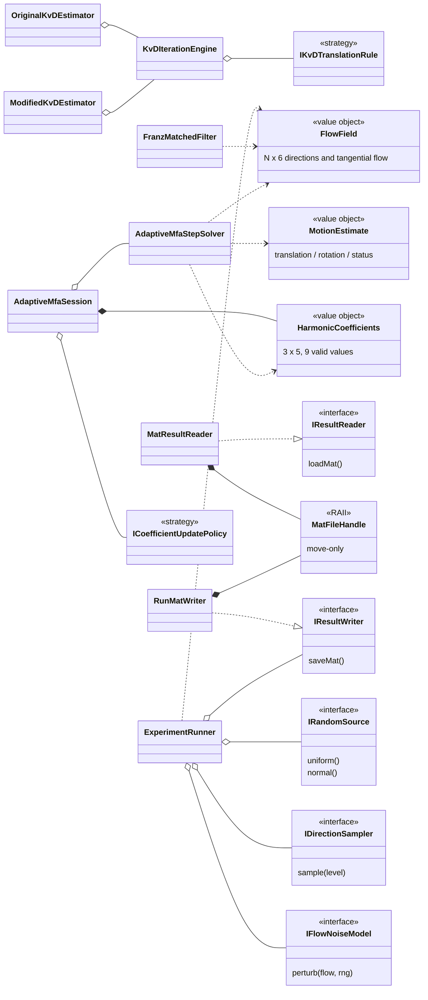
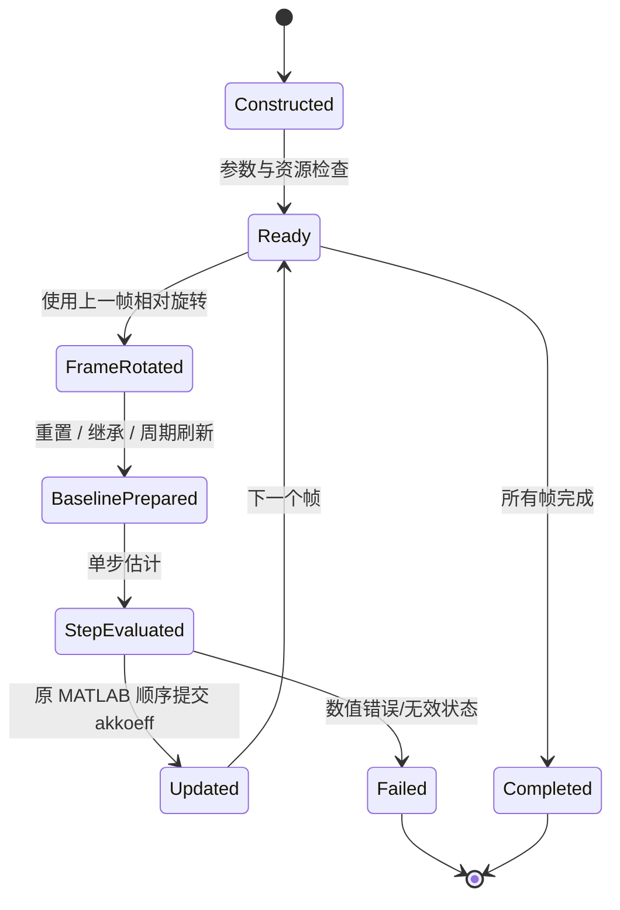

# 对象模型与生命周期合同（Object Model）

> **P0.7 / P0.8 的设计草案，尚未冻结、没有 C++ 对应类实现。** 依据原始 MATLAB 文件、[ARCHITECTURE.md](ARCHITECTURE.md) 和 [PLAN.md](../PLAN.md)；需求义务见 [REQUIREMENTS.md](REQUIREMENTS.md)。本文件作为 HLD 的附件、后续 LLD 的上游输入。

## 1. 对象职责和约定

### 1.1 类、接口、值对象的职责

以下名称是**拟设计的 C++ 类或值类型**，尚未创建；接口细节需在 P0 调用关系与数据形状审计后固定。类型和方法名称只代表职责，不要求必须逐字采用。

| 类/接口/值对象 | 必须封装的状态或职责 | MATLAB 来源与直接依赖 |
|---|---|---|
| **FlowField**（值对象） | 拥有 N×6 列主序流场；提供只读方向、切向光流访问及形状校验；不持有文件句柄 | 各脚本的 setofpoints；Eigen |
| **MotionEstimate**、**SolverResult**（值对象） | 分别表示 t、ω、近度/迭代数和有限性/退化/失败状态；不借用临时数据 | KvD、franzeigen、oneit 的输出 |
| **HarmonicCoefficients**（值对象） | 精确保留 3×5 存储及 1+3+5 有效位置；记录零阶项与 8 个非零阶参数的区别 | altkoeff、neukoeff、akkoeff、mitkoeff |
| **MatFileHandle**、**MatVariableHandle**（RAII） | move-only；分别拥有 mat_t*、matvar_t*；禁止复制与越期借用；只读句柄不可转换成写句柄 | matio C API；禁止泄漏到领域层 |
| **MatResultReader** / **RunMatWriter** | 前者只读原始及结果 MAT，支持按变量名读取与 getflowfield 兼容模式；后者只能写入明确的独立结果根目录 | getflowfield、load、save；由 RAII 提供访问 |
| **IResultReader** / **IResultWriter**（窄接口） | 为实验/分析层提供按业务含义读取或写入数据的契约；测试可替换成内存存储 | MatResultReader、RunMatWriter；不暴露 matio |
| **IRandomSource**（接口） | 产生 uniform / normal 样本；每次实验持有独立 RNG；支持固定序列测试替身 | RandStream、rand、randn；具体实现为 Mt19937RandomSource、FixedSequenceRandomSource |
| **IDirectionSampler**（接口） | 按指定细分级别返回视线集合；实现 OctahedralSampler、OccludedOctahedralSampler、IcosahedralSampler | findeDreiecke 与三个入口采样函数 |
| **IFlowNoiseModel**（接口） | 只负责从原始流场和随机源生成加噪流场；实现 MeanMagnitudeGaussianNoise、ComponentGaussianNoise、NoNoise | fixed_kugel...、fixed_propfehler...、nonpropfehler |
| **FlowSynthesizer** | 合成平移/旋转切向光流及其平均模长；无跨帧状态 | erzeugeflussausnear；sampling、math3d |
| **SphereEnvironment** | 单位球体内射线相交与近度计算；不管理轨迹状态 | getnear_in_kugel_Drehung |
| **FranzMatchedFilter** | 执行三轴平移/旋转模板响应及原版归一化，返回明确运动估计值；无历史状态 | zellendefinieren、franzeigen |
| **KvDIterationEngine** | 封装共享的初始化、近度重估、残差、旋转更新和停止逻辑，保留每次更新的顺序 | norm_koenderink_iteration、mue_norm_koenderink_iteration |
| **IKvDTranslationRule**（内部策略）及 **OriginalKvDEstimator**、**ModifiedKvDEstimator** | 两种不同的平移更新法则与明确命名的求解器入口；不通过容易误设的布尔参数悄悄切换算法 | KvD 原始与修正方程；共享 KvDIterationEngine |
| **RealSphericalHarmonics**、**HarmonicFitter**、**HarmonicRotator** | 分别负责基函数/近度重建、逐项拟合、l≤2 旋转；不持有实验历史状态 | kugelflfunc2、near_aus_koeff、koeff_aus_near、SHRotate、transfor_koeff |
| **AdaptiveMfaStepSolver** | **无状态单轮计算**：从旧系数和 N×6 流场构造 6×6 系统并返回运动、残差、新系数；不继承 KvD | oneit_adaptiv_matched_filter |
| **AdaptiveMfaSession** | 拥有一次轨迹运行中的当前 akkoeff；执行“上一帧旋转→本帧求解→提交后验系数”的确定时序 | adaptive 三种 data_generation 入口 |
| **ICoefficientUpdatePolicy**（接口） | 维护只与基线对比相关的更新规则：每帧重置、每帧继承、按 1/5/11/21 帧刷新；不能偷改真正的 akkoeff 主状态 | ohnekoeff、mitkoeff、zeitkonstanten |
| **TrajectoryGenerator**、**TrajectoryKinematics** | 分别生成圆/正弦点序列，以及绝对/相对旋转和局部平移；不用加载 MAT | kreis_trajektorie、sinuskurve_trajektorie、trajektorie_aus_punkten |
| **BiasExperimentRunner**、**InitializationRunner**、**AdaptiveComparisonRunner**、**UpdateRateRunner** | **每个入口一个编排对象**；只组合模拟、估计、误差、保存服务，不重复具体算法方程 | 五个 MATLAB data_generation 入口；Bias 的两种模式共享 Runner + 明确配置 |
| **BiasResultAnalyzer**、**AdaptiveResultAnalyzer** | 读取结果、统计 40 个偏差运行和三类自适应轨迹结果；输出可绘制的数值序列 | 四个 data_analysis 脚本 |
| **IPlotExporter**（可选接口） | 仅接收分析后的绘图数据；不允许修改数值结果，不作为核心程序运行依赖 | graphs_*.m 与 illustrations/ |
| **CommandDispatcher** / **ApplicationCompositionRoot** | CLI 解析、选择实验配置、建立对象依赖图；不持有算法公式、不把路径或原始 C 指针传入求解器 | 新项目的 C++ 应用入口 |

**重要说明**：I 开头的接口只用于确有替换需求的依赖边界。对简单数学运算，应使用普通函数而不是建立继承体系；具体不变量和返回值规范需在实现子任务中确定，不应提前创建大而全的基类。

### 1.2 所有权与生命周期

| 运行实体 | 谁创建和拥有 | 生命周期及不可违反的规则 |
|---|---|---|
| 原始 MATLAB 目录 | 外部只读仓库数据，非 C++ 对象所有 | 原路径和原文件必须保持不变；不得通过其他输出路径、软链接或相对路径逃逸覆盖 |
| MatFileHandle / MatVariableHandle | I/O 层局部对象 | 作用域结束立即释放；不得在返回给算法层的 Eigen 引用中保留已失效的内存 |
| FlowField、MotionEstimate、HarmonicCoefficients | 由业务对象按值拥有 | 输出对象可在句柄销毁后独立存在；维度、坐标和存储顺序在构造时验证 |
| IRandomSource 具体对象 | 每个实验运行的 RunContext | 只在本 RunId 内被消费；严格保留原版 rand/randn 调用先后次序；多运行/多线程不能共享隐式可变 RNG |
| Estimator / StepSolver | 实验编排对象通过构造注入或组合持有 | 数学求解器尽量无状态；共享只读参数；不保存上一帧会话状态 |
| AdaptiveMfaSession / 更新策略 | 一个轨迹实例一个会话 | 负责前一帧旋转、主系数状态、对比基线的独立系数、刷新时刻和当前帧结果提交 |
| RunMatWriter / 结果目录 | 每个 RunContext 独占 | 输出位置在写入前确认不属于 origin/**；默认拒绝覆盖已有实验结果；失败日志独立保存 |
| Analyzer / PlotExporter | 由相应分析命令创建 | 只消费数值结果；生成图表失败不得导致已经计算的结果丢失 |

- **依赖方向**：CLI/实验运行器 → 领域值对象 + 窄接口 → 数学/求解器；MAT、绘图等第三方组件只在基础设施实现层出现；领域层与求解器不得 import/include matio。
- **结果类型**：业务错误按类别明确返回（MAT 格式不符、找不到变量、维度错误、零范数、近度归一化失败、病态系统、非有限值、无效角度）；可用兼容 C++17 的显式结果值/错误对象，不把数值失败当作正常 0。保留 MATLAB 原版原始行为的证据，安全边界处理单独标注，不暗改基准结果。
- **不制造通用求解器假象**：Franz 基线、KvD 完整迭代、Adaptive 单步的输入与输出不完全相同；可以共享 FlowField、MotionEstimate 等值对象，但不强制通过一个会丢失 near、coeff 或迭代状态的统一基类。
- **构造时注入**：BiasExperimentRunner 由采样器、NoiseModel、Franz/KvD 求解器、随机源和结果写入器组成；Adaptive Runner 由轨迹、SphereEnvironment、采样器、StepSolver、状态会话、噪声策略和结果写入器组成。运行器不根据字符串自行 new 具体类型，具体选择集中在 ApplicationCompositionRoot。
- **迭代和状态更新的顺序**：KvDIterationEngine 的每步残差/停止检查遵循 MATLAB 的原始顺序；AdaptiveMfaSession 在 i 帧首先旋转上一帧系数，再为各个基线按策略更新，然后分别调用无状态单步求解，最后更新主 akkoeff。策略不得越权修改主状态。
- **测试替身**：纯算法和模拟器测试可以注入 FixedSequenceRandomSource、固定采样器、内存结果读写器；不依赖真实 MAT 文件；MAT 读写集成测试则必须使用原始归档或专门的测试 MAT 并明确测试范围。

## 2. 组件对象关系（设计草案）

图中“接口方法”是接口能力描述，不是最终的 C++17 签名。实际类是否使用动态多态，应以是否存在替换需求、测试隔离需求和运行成本测量为依据；不得为单一函数强制建立虚类。

## 3. 值对象不变量与读写权

| 值或对象 | 不变量 | 拥有方及禁忌 |
|---|---|---|
| FlowField | N×6，列主序；前三列视线、后三列切向流；非法 N/数据明确错误 | Runner/求解器按值持有，不能指向已释放 MAT 缓冲区 |
| HarmonicCoefficients | 3×5，只有 1+3+5 有效项；零阶与其他系数语义不混合 | AdaptiveMfaSession 独占可写主系数，不共享到其他 RunContext |
| MotionEstimate / SolverResult | t、ω、迭代/残差/状态独立；数值退化不能默认为成功 | 每次调用生成独立结果，测试可比较全部字段 |
| MatFileHandle / MatVariableHandle | 非复制、可移动；有效句柄恰有一个释放者 | I/O 层私有；原始数据只允许只读打开 |
| RunMatWriter | 每次写入目标位于独立 RunId；拒绝覆盖历史 | 每次实验一个结果目录；不信任未验证的路径拼接 |
| IRandomSource | 每个 RunContext 独立实例和状态；调用顺序可追踪 | Runner 创建，模拟模块临时借用，不跨实验共享 |
| AdaptiveMfaSession | 主系数唯一写入者；上一帧旋转与本帧更新时序固定 | 一条轨迹一实例；不承诺同 Session 多线程安全 |

## 4. 生命周期与状态机

**特别说明**：异常时是否提交主系数、是否跳过当前帧、是否终止，需要对原 MATLAB 的真实行为和固定基准验证后冻结；状态图只提出候选边界，不可直接当作代码行为事实。

## 5. 与模块边界相关的规则

- 领域数学不可依赖 MAT、CLI 或绘图；基础数学的点积、叉积、球谐基函数可以是无状态自由函数。
- 不存在一个对 Franz、KvD、Adaptive 强制统一输入/输出的“所有算法基类”。它们只能共享真正共同的值类型和小接口。
- MAT 读取的资源所有权不通过 Eigen Map 借用跨越文件句柄生命周期；必要时使用数据拷贝并在基准中记录内存影响。
- 原始/Modified KvD 各有独立入口，平移更新策略需可被测试确认，不能以 `bool modified` 隐藏公式差异。
- 轨迹运行器拥有 Session、RNG、参数、输出 Writer；分析对象消费已经保存的结果，不得重新运行 solver 或改变结果数据。
- 使用 C++17 的显式结果/错误类型，无需引入 C++23 特性；具体错误枚举在 LLD 中冻结。

## 6. P0.7 / P0.8 验收清单

- [ ] 将 45 个 MATLAB 文件分别落实到设计对象的方法、数学函数或明确不需要运行的图表能力。
- [ ] 每个类标注“是否有状态/谁创建/谁释放/可否复制或移动/可否并行调用”。
- [ ] 所有接口明确输入形状、单位、前置条件、无效输入、后置条件和可观察输出。
- [ ] 接口依赖方向无环；所有权声明没有双重释放或悬垂引用风险。
- [ ] 用固定随机源、采样器和内存结果仓库构造独立单元测试，而不触碰原始 MAT。
- [ ] 第三方源代码和 MAT schema 未确认的设计点标注为阻塞/待确认。
- [ ] 由项目维护者批准对象模型和约束后，才在详细设计和 C++ 头文件中固定方法签名。

本文件只提供设计审查材料。**未编译、未创建类、未通过测试；P0.7/P0.8 尚未完成。**
