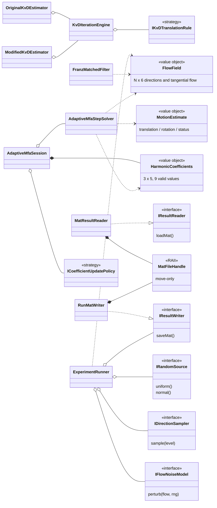
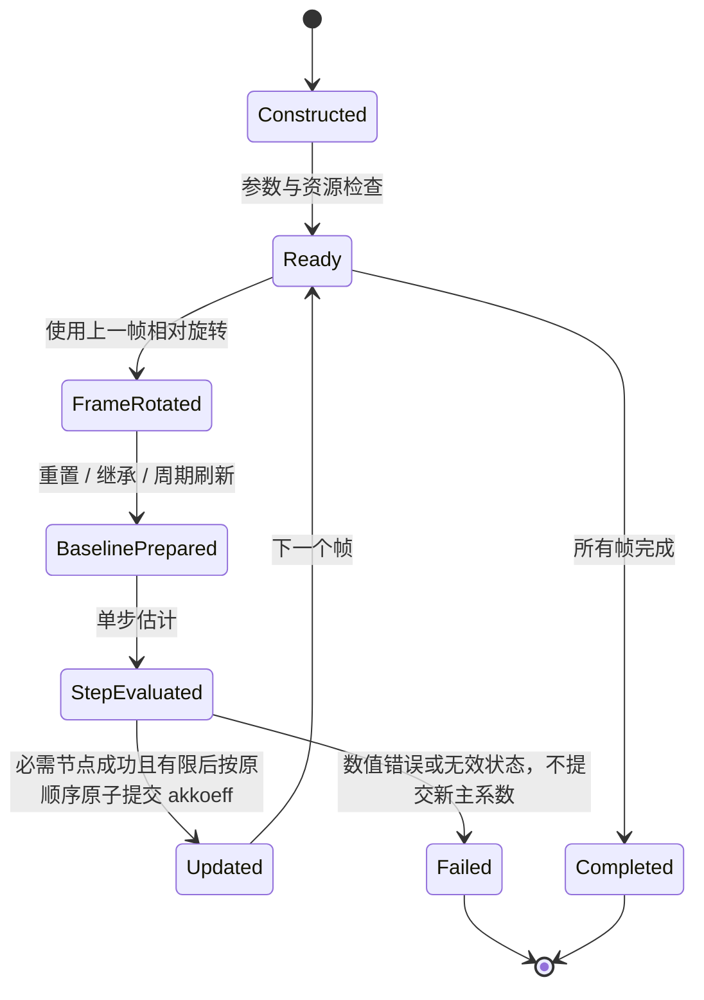

# 对象模型与生命周期合同（Object Model）

> **对象模型草案 v0.5；P0.7/P0.8 待评审，未冻结、未建立对应 C++ 类。** 依据原始 MATLAB 文件、[ARCHITECTURE.md](ARCHITECTURE.md) 和 [PLAN.md](PLAN.md)；需求义务见 [REQUIREMENTS.md](REQUIREMENTS.md)。本文件作为 HLD 的附件、后续 LLD 的上游输入；各文档当前版本、固定 SHA 和冻结状态统一由 [文档控制矩阵](DOCUMENT_BASELINE_REGISTER.md) 登记，运行结果以 [PROGRESS](PROGRESS.md) 为准。

## 1. 对象职责和约定

### 1.1 类、接口、值对象的职责

以下名称是**拟设计的 C++ 类或值类型**，尚未创建；接口细节需在 P0 调用关系与数据形状审计后固定。类型和方法名称只代表职责，不要求必须逐字采用。

| 类/接口/值对象 | 必须封装的状态或职责 | MATLAB 来源与直接依赖 |
|---|---|---|
| **FlowField**（值对象） | 拥有 N×6 列主序流场；提供只读方向、切向光流访问及形状校验；不持有文件句柄 | 各脚本的 setofpoints；Eigen |
| **MotionEstimate**、**SolverResult**（值对象） | 分别表示 t、ω、近度/迭代数和有限性/退化/失败状态；不借用临时数据 | KvD、franzeigen、oneit 的输出 |
| **HarmonicCoefficients**（值对象） | 精确保留 3×5 存储及 1+3+5 有效位置；记录零阶项与 8 个非零阶参数的区别 | altkoeff、neukoeff、akkoeff、mitkoeff |
| **MatFileHandle**、**MatVariableHandle**（RAII） | move-only；分别拥有 mat_t*、matvar_t*；禁止复制与越期借用；只读句柄不可转换成写句柄 | matio C API；禁止泄漏到领域层 |
| **MatResultReader** / **RunMatWriter** | 前者只读原始及结果 MAT，支持按变量名读取与 getflowfield 兼容模式；后者只能写入明确的独立结果根目录 | getflowfield、load、save；由 RAII 提供访问 |
| **IResultReader** / **IResultWriter**（窄接口） | 为实验/分析层提供按业务含义读取或写入数据的契约；测试可替换成内存存储 | MatResultReader、RunMatWriter；不暴露 matio |
| **IRandomSource**（接口） | 产生 uniform / normal 样本；每次实验持有独立 RNG；支持固定序列测试替身 | RandStream、rand、randn；具体实现为 Mt19937RandomSource、FixedSequenceRandomSource |
| **IDirectionSampler**（接口） | 按指定细分级别返回视线集合；实现 OctahedralSampler、OccludedOctahedralSampler、IcosahedralSampler | findeDreiecke 与三个入口采样函数 |
| **IFlowNoiseModel**（接口） | 只负责从原始流场和随机源生成加噪流场；实现 MeanMagnitudeGaussianNoise、ComponentGaussianNoise、NoNoise | fixed_kugel...、fixed_propfehler...、nonpropfehler |
| **FlowSynthesizer** | 合成平移/旋转切向光流及其平均模长；无跨帧状态 | erzeugeflussausnear；sampling、math3d |
| **SphereEnvironment** | 单位球体内射线相交与近度计算；不管理轨迹状态 | getnear_in_kugel_Drehung |
| **FranzMatchedFilter** | 执行三轴平移/旋转模板响应及原版归一化，返回明确运动估计值；无历史状态 | zellendefinieren、franzeigen |
| **KvDIterationEngine** | 封装共享的初始化、近度重估、残差、旋转更新和停止逻辑，保留每次更新的顺序 | norm_koenderink_iteration、mue_norm_koenderink_iteration |
| **IKvDTranslationRule**（内部策略）及 **OriginalKvDEstimator**、**ModifiedKvDEstimator** | 两种不同的平移更新法则与明确命名的求解器入口；不通过容易误设的布尔参数悄悄切换算法 | KvD 原始与修正方程；共享 KvDIterationEngine |
| **RealSphericalHarmonics**、**HarmonicFitter**、**HarmonicRotator** | 分别负责基函数/近度重建、逐项拟合、l≤2 旋转；不持有实验历史状态 | kugelflfunc2、near_aus_koeff、koeff_aus_near、SHRotate、transfor_koeff |
| **AdaptiveMfaStepSolver** | **无状态单轮计算**：从旧系数和 N×6 流场构造 6×6 系统并返回运动、残差、新系数；不继承 KvD | oneit_adaptiv_matched_filter |
| **AdaptiveMfaSession** | 拥有一次轨迹运行中的当前 akkoeff；执行“上一帧旋转→本帧求解→提交后验系数”的确定时序 | adaptive 三种 data_generation 入口 |
| **ICoefficientUpdatePolicy**（接口） | 维护只与基线对比相关的更新规则：每帧重置、每帧继承、按 1/5/11/21 帧刷新；不能偷改真正的 akkoeff 主状态 | ohnekoeff、mitkoeff、zeitkonstanten |
| **TrajectoryGenerator**、**TrajectoryKinematics** | 分别生成圆/正弦点序列，以及绝对/相对旋转和局部平移；不用加载 MAT | kreis_trajektorie、sinuskurve_trajektorie、trajektorie_aus_punkten |
| **BiasExperimentRunner**、**InitializationRunner**、**AdaptiveComparisonRunner**、**UpdateRateRunner** | **每个入口一个编排对象**；只组合模拟、估计、误差、保存服务，不重复具体算法方程 | 五个 MATLAB data_generation 入口；Bias 的两种模式共享 Runner + 明确配置 |
| **BiasResultAnalyzer**、**AdaptiveResultAnalyzer** | 读取结果、统计 40 个偏差运行和三类自适应轨迹结果；输出可绘制的数值序列 | 四个 data_analysis 脚本 |
| **IPlotExporter**（可选接口） | 仅接收分析后的绘图数据；不允许修改数值结果，不作为核心程序运行依赖 | graphs_*.m 与 illustrations/ |
| **CommandDispatcher** / **ApplicationCompositionRoot** | CLI 解析、选择实验配置、建立对象依赖图；不持有算法公式、不把路径或原始 C 指针传入求解器 | 新项目的 C++ 应用入口 |

**重要说明**：I 开头的接口只用于确有替换需求的依赖边界。对简单数学运算，应使用普通函数而不是建立继承体系；具体不变量和返回值规范需在实现子任务中确定，不应提前创建大而全的基类。

### 1.2 所有权与生命周期

| 运行实体 | 谁创建和拥有 | 生命周期及不可违反的规则 |
|---|---|---|
| 原始 MATLAB 目录 | 外部只读仓库数据，非 C++ 对象所有 | 原路径和原文件必须保持不变；不得通过其他输出路径、软链接或相对路径逃逸覆盖 |
| MatFileHandle / MatVariableHandle | I/O 层局部对象 | 作用域结束立即释放；不得在返回给算法层的 Eigen 引用中保留已失效的内存 |
| FlowField、MotionEstimate、HarmonicCoefficients | 由业务对象按值拥有 | 输出对象可在句柄销毁后独立存在；维度、坐标和存储顺序在构造时验证 |
| IRandomSource 具体对象 | 每个实验运行的 RunContext | 只在本 RunId 内被消费；严格保留原版 rand/randn 调用先后次序；多运行/多线程不能共享隐式可变 RNG |
| Estimator / StepSolver | 实验编排对象通过构造注入或组合持有 | 数学求解器尽量无状态；共享只读参数；不保存上一帧会话状态 |
| AdaptiveMfaSession / 更新策略 | 一个轨迹实例一个会话 | 负责前一帧旋转、主系数状态、对比基线的独立系数、刷新时刻和当前帧结果提交 |
| RunMatWriter / 结果目录 | 每个 RunContext 独占 | 输出位置在写入前确认不属于 origin/**；默认拒绝覆盖已有实验结果；失败日志独立保存 |
| Analyzer / PlotExporter | 由相应分析命令创建 | 只消费数值结果；生成图表失败不得导致已经计算的结果丢失 |

- **依赖方向**：CLI/实验运行器 → 领域值对象 + 窄接口 → 数学/求解器；MAT、绘图等第三方组件只在基础设施实现层出现；领域层与求解器不得 import/include matio。
- **结果类型**：业务错误按类别明确返回（MAT 格式不符、找不到变量、维度错误、零范数、近度归一化失败、病态系统、非有限值、无效角度）；可用兼容 C++17 的显式结果值/错误对象，不把数值失败当作正常 0。保留 MATLAB 原版原始行为的证据，安全边界处理单独标注，不暗改基准结果。
- **不制造通用求解器假象**：Franz 基线、KvD 完整迭代、Adaptive 单步的输入与输出不完全相同；可以共享 FlowField、MotionEstimate 等值对象，但不强制通过一个会丢失 near、coeff 或迭代状态的统一基类。
- **构造时注入**：BiasExperimentRunner 由采样器、NoiseModel、Franz/KvD 求解器、随机源和结果写入器组成；Adaptive Runner 由轨迹、SphereEnvironment、采样器、StepSolver、状态会话、噪声策略和结果写入器组成。运行器不根据字符串自行 new 具体类型，具体选择集中在 ApplicationCompositionRoot。
- **迭代和状态更新的顺序**：KvDIterationEngine 的每步残差/停止检查遵循 MATLAB 的原始顺序；AdaptiveMfaSession 在 i 帧首先旋转上一帧系数，再为各个基线按策略更新，然后分别调用无状态单步求解，最后更新主 akkoeff。策略不得越权修改主状态。
- **测试替身**：纯算法和模拟器测试可以注入 FixedSequenceRandomSource、固定采样器、内存结果读写器；不依赖真实 MAT 文件；MAT 读写集成测试则必须使用原始归档或专门的测试 MAT 并明确测试范围。

## 2. 组件对象关系（设计草案）

图中“接口方法”是接口能力描述，不是最终的 C++17 签名。实际类是否使用动态多态，应以是否存在替换需求、测试隔离需求和运行成本测量为依据；不得为单一函数强制建立虚类。

## 3. 值对象不变量与读写权

| 值或对象 | 不变量 | 拥有方及禁忌 |
|---|---|---|
| FlowField | N×6，列主序；前三列视线、后三列切向流；非法 N/数据明确错误 | Runner/求解器按值持有，不能指向已释放 MAT 缓冲区 |
| HarmonicCoefficients | 3×5，只有 1+3+5 有效项；零阶与其他系数语义不混合 | AdaptiveMfaSession 独占可写主系数，不共享到其他 RunContext |
| MotionEstimate / SolverResult | t、ω、迭代/残差/状态独立；数值退化不能默认为成功 | 每次调用生成独立结果，测试可比较全部字段 |
| MatFileHandle / MatVariableHandle | 非复制、可移动；有效句柄恰有一个释放者 | I/O 层私有；原始数据只允许只读打开 |
| RunMatWriter | 每次写入目标位于独立 RunId；拒绝覆盖历史 | 每次实验一个结果目录；不信任未验证的路径拼接 |
| IRandomSource | 每个 RunContext 独立实例和状态；调用顺序可追踪 | Runner 创建，模拟模块临时借用，不跨实验共享 |
| AdaptiveMfaSession | 主系数唯一写入者；上一帧旋转与本帧更新时序固定 | 一条轨迹一实例；不承诺同 Session 多线程安全 |

## 4. 生命周期与状态机

**已确定的状态安全原则（不是待决事项）**：Adaptive StepSolver 只有在所需节点全部成功且结果有效时，Session 才按原实验更新次序**原子提交**下一帧主系数；失败不得提交新主系数。若连续序列无法安全恢复，**停止当前轨迹**，由 Runner 将部分运行标记为 Incomplete/Failed 并保留真实有效样本数和错误证据；独立样本可记录失败后继续其他独立样本。图中的 Failed→终止描述**不能安全恢复时的默认路径**，不暗示自动跳过/重试；特殊恢复路径的资格、非有限输入及实际异常测试仍须独立 L3/CTest 核验。设计依据见 [Adaptive LLD](design/adaptive_mfa.md)、[Runner LLD](design/experiments.md) 和 [所有者决定](decisions/PROJECT_OWNER_DECISIONS_2026-11-07.md)。**本状态机尚未实现/执行，不要求 MATLAB L1**。

## 5. 与模块边界相关的规则

- 领域数学不可依赖 MAT、CLI 或绘图；基础数学的点积、叉积、球谐基函数可以是无状态自由函数。
- 不存在一个对 Franz、KvD、Adaptive 强制统一输入/输出的“所有算法基类”。它们只能共享真正共同的值类型和小接口。
- MAT 读取的资源所有权不通过 Eigen Map 借用跨越文件句柄生命周期；必要时使用数据拷贝并在基准中记录内存影响。
- 原始/Modified KvD 各有独立入口，平移更新策略需可被测试确认，不能以 `bool modified` 隐藏公式差异。
- 轨迹运行器拥有 Session、RNG、参数、输出 Writer；分析对象消费已经保存的结果，不得重新运行 solver 或改变结果数据。
- 使用 C++17 的显式结果/错误类型，无需引入 C++23 特性；具体错误枚举在 LLD 中冻结。

## 6. P0.7 / P0.8 验收清单

- [ ] 将 45 个 MATLAB 文件分别落实到设计对象的方法、数学函数或明确不需要运行的图表能力。
- [ ] 每个类标注“是否有状态/谁创建/谁释放/可否复制或移动/可否并行调用”。
- [ ] 所有接口明确输入形状、单位、前置条件、无效输入、后置条件和可观察输出。
- [ ] 接口依赖方向无环；所有权声明没有双重释放或悬垂引用风险。
- [ ] 用固定随机源、采样器和内存结果仓库构造独立单元测试，而不触碰原始 MAT。
- [ ] 第三方源代码和 MAT schema 未确认的设计点标注为阻塞/待确认。
- [ ] 由项目维护者批准对象模型和约束后，才在详细设计和 C++ 头文件中固定方法签名。

本文件只提供设计审查材料。**未编译、未创建类、未通过测试；P0.7/P0.8 尚未完成。**

## 7. 原 MATLAB 45 文件 → 预定 C++ 类方法/自由函数映射（P0.7）

**这是设计分配表，不是实现清单。** MATLAB 文件名和路径已在源树核对；右列只是拟定责任归属与能力名称，未创建 C++ 类、方法或测试。具体函数签名、参数、source SHA 与对应 REQ/TC 见 SRS §9.2 及模块 LLD，后续要逐项冻结。

| 原始文件（相对于 origin 数据根目录） | 拟定拥有职责的类/函数 | 设计/验证状态 |
|---|---|---|
| `adaptive_matched_filter_test/data_analysis/graph_agent_in_sphere_adaptive_matched_filter_many_parameter.m` | AdaptiveResultAnalyzer::updateRates | 已定位 / 合同待 P0 核验 |
| `adaptive_matched_filter_test/data_analysis/graph_agent_in_sphere_adaptive_matched_filter_test.m` | AdaptiveResultAnalyzer::comparison | 已定位 / 合同待 P0 核验 |
| `adaptive_matched_filter_test/data_analysis/graph_agent_in_sphere_initialization_test.m` | AdaptiveResultAnalyzer::initialization | 已定位 / 合同待 P0 核验 |
| `adaptive_matched_filter_test/data_generation/agent_in_sphere_adaptive_matched_filter_many_parameter.m` | UpdateRateRunner::run | 已定位 / 合同待 P0 核验 |
| `adaptive_matched_filter_test/data_generation/agent_in_sphere_adaptive_matched_filter_test.m` | AdaptiveComparisonRunner::run | 已定位 / 合同待 P0 核验 |
| `adaptive_matched_filter_test/data_generation/agent_in_sphere_initialization_test.m` | InitializationRunner::run | 已定位 / 合同待 P0 核验 |
| `bias_test/data_analysis/graphs_bias_test.m` | BiasResultAnalyzer::aggregate | 已定位 / 合同待 P0 核验 |
| `bias_test/data_generation/bias_test_nonspherical.m` | BiasExperimentRunner::runOccluded | 已定位 / 合同待 P0 核验 |
| `bias_test/data_generation/bias_test_spherical_prop_error.m` | BiasExperimentRunner::runProportional | 已定位 / 合同待 P0 核验 |
| `help_functions/SHRotate.m` | `egomotion::harmonics::HarmonicRotator::blocks(const Eigen::Matrix3d&) const`；通过 [球谐专题 LLD §3](design/SH_ROTATION_IVANIC_RUEDENBERG.md) 的唯一声明生成 R3/R5（R0=1 不存可变成员）；按 Ivanic–Ruedenberg 1996 原文及 1998 勘误 **纯 Eigen 重写**，Don Williamson 仅供参考、禁止 sdla | 实现数学路线已选；此处仅**预定方法声明及源码映射**，未创建 `.hpp/.cpp`、未核对上传的论文全文、未运行 CTest |
| `help_functions/drehvektor_aus_zwei_vektoren.m` | math::rotationVectorBetween (自由函数) | 已定位 / 合同待 P0 核验 |
| `help_functions/erzeugeflussausnear.m` | FlowSynthesizer::synthesize | 已定位 / 合同待 P0 核验 |
| `help_functions/erzeugekreuzproduktmatrix.m` | math::crossMatrix (自由函数) | 已定位 / 合同待 P0 核验 |
| `help_functions/erzeugerichtungsvektoren.m` | OctahedralSampler::sample | 已定位 / 合同待 P0 核验 |
| `help_functions/erzeugerichtungsvektoren_loch.m` | OccludedOctahedralSampler::sample | 已定位 / 合同待 P0 核验 |
| `help_functions/findeDreiecke.m` | sampling::subdivideTriangle (私有自由函数) | 已定位 / 合同待 P0 核验 |
| `help_functions/fixed_kugel_symmetric_perfectpoints_randomnear.m` | BiasExperimentRunner::synthesizeOccludedInput（组合采样、FlowSynthesizer、噪声策略） | 已定位 / 合同待 P0 核验 |
| `help_functions/fixed_propfehler_kugel_symmetric_perfectpoints_randomnear.m` | BiasExperimentRunner::synthesizeProportionalInput（组合采样、FlowSynthesizer、噪声策略） | 已定位 / 合同待 P0 核验 |
| `help_functions/franzeigen.m` | FranzMatchedFilter::estimate | 已定位 / 合同待 P0 核验 |
| `help_functions/getflowfield.m` | MatResultReader::readFirstCompatible | 已定位 / 合同待 P0 核验 |
| `help_functions/getnear_in_kugel_Drehung.m` | SphereEnvironment::nearness | 已定位 / 合同待 P0 核验 |
| `help_functions/getvektor.m` | sampling::randomUnitDirection(IRandomSource&)（无状态自由函数） | 已定位 / 合同待 P0 核验 |
| `help_functions/koeff_aus_near.m` | HarmonicFitter::fit | 已定位 / 合同待 P0 核验 |
| `help_functions/kreis_trajektorie.m` | TrajectoryGenerator::circle | 已定位 / 合同待 P0 核验 |
| `help_functions/kreuzprodukt.m` | math::cross (自由函数) | 已定位 / 合同待 P0 核验 |
| `help_functions/kugelflfunc2.m` | RealSphericalHarmonics::evaluate | 已定位 / 合同待 P0 核验 |
| `help_functions/kurveglaetten.m` | analysis::windowMean (自由函数) | 已定位 / 合同待 P0 核验 |
| `help_functions/mue_norm_koenderink_iteration.m` | ModifiedKvDEstimator::estimate | 已定位 / 合同待 P0 核验 |
| `help_functions/near_aus_koeff.m` | RealSphericalHarmonics::reconstruct | 已定位 / 合同待 P0 核验 |
| `help_functions/nonpropfehler.m` | MeanMagnitudeGaussianNoise::apply | 已定位 / 合同待 P0 核验 |
| `help_functions/norm_koenderink_iteration.m` | OriginalKvDEstimator::estimate | 已定位 / 合同待 P0 核验 |
| `help_functions/normrelfehler.m` | metrics::directionAngleDeg | 已定位 / 合同待 P0 核验 |
| `help_functions/oneit_adaptiv_matched_filter.m` | AdaptiveMfaStepSolver::solve | 已定位 / 合同待 P0 核验 |
| `help_functions/richtungsvektoren_icosahedron.m` | IcosahedralSampler::sample | 已定位 / 合同待 P0 核验 |
| `help_functions/rodrigues.m` | math::rotationVectorToMatrix，内层规划调用 Sophus::SO3d::exp()（仅实际使用的向量→矩阵分支） | H-02 已选定 Sophus；零角/小角与 Rᵀ 值待对照，未编码 |
| `help_functions/sinuskurve_trajektorie.m` | TrajectoryGenerator::sine | 已定位 / 合同待 P0 核验 |
| `help_functions/skalarprodukt.m` | math::dot (自由函数) | 已定位 / 合同待 P0 核验 |
| `help_functions/trajektorie_aus_punkten.m` | TrajectoryKinematics::fromPoints | 已定位 / 合同待 P0 核验 |
| `help_functions/transfehler_div.m` | metrics::scaleAlignedVectorError | 已定位 / 合同待 P0 核验 |
| `help_functions/transfor_koeff.m` | `egomotion::harmonics::HarmonicRotator::rotate`；接口声明见 [球谐专题 LLD §3](design/SH_ROTATION_IVANIC_RUEDENBERG.md) | 已定位 / 仅声明草案，待 P0.8 审阅；没有实现 |
| `help_functions/winkelausvektor.m` | math::directionToAngles | 已定位 / 合同待 P0 核验 |
| `help_functions/zellendefinieren.m` | FranzMatchedFilter::axisTemplates | 已定位 / 合同待 P0 核验 |
| `illustrations/circle_curve_in_the_sphere.m` | IPlotExporter::drawCircleInSphere (可选) | 已定位 / 合同待 P0 核验 |
| `illustrations/sinosodial_curve_in_the_sphere.m` | IPlotExporter::drawSineInSphere (可选) | 已定位 / 合同待 P0 核验 |
| `illustrations/spherical_harmonic_illustration.m` | IPlotExporter::drawHarmonic (可选) | 已定位 / 合同待 P0 核验 |

- 无状态的点积、叉积、采样递归、误差公式优先使用自由函数，**不要为了“45/45 面向对象”而强行创建 45 个类**。
- 实验入口统一由 Runner 调度，但必须保留各自独立的参数和存储合同。历史 MAT 结果的分析与绘图不反向依赖求解器。
- 原 `rodrigues.m`、`SHRotate.m` 保持只读源资料。物理旋转采用 Sophus；球谐旋转以 **Ivanic–Ruedenberg 1996 原文和 1998 勘误**为数学依据，**Eigen-only 独立重写** l≤2 的 R0/R3/R5；Don Williamson 仅作为源代码参考，**不得引入 sdla 的头文件、链接库或间接依赖**。仓库原创部分使用 MIT，引用实际第三方文件时保留其现有来源告知；不以一般版权复核阻塞研发。相关 C++ 头/源文件本轮仅作声明级设计，尚未创建或实现。
- 对一份 MATLAB 文件内多个辅助函数或附加可调用模式，P0.2 必须另列到方法级迁移表；本表仅记录每个文件的首要职责，不等于逐函数审计已全部完成。

### 7.1 名称一致性与职责边界

- `fixed_kugel_symmetric_perfectpoints_randomnear.m` 和 `fixed_propfehler_kugel_symmetric_perfectpoints_randomnear.m` 的场景编排暂归 `BiasExperimentRunner`；实际三维光流仍由 `FlowSynthesizer`、采样器和噪声模型分别承担，避免引入未定义的额外 `BiasSceneGenerator`。
- `getvektor.m` 暂归 `sampling::randomUnitDirection(IRandomSource&)`，以注入的随机源生成单个球面单位方向；无需人为建立持有可变状态的 `SphericalRandomDirection` 类。
- 以上是**规划名称统一**，不代表实际头文件、方法签名已存在。若 P0.7 评审后需要调整实现名称，应在同一次文档变更中同步修改本文件、HLD、相关 LLD 和 45 文件追踪矩阵，不更改 MATLAB 源路径或数值合同。

### 7.2 对象模型门禁与 LLD 门禁区别

| 门禁 | 最小判定内容 | 当前状态 |
|---|---|---|
| 对象模型评审（P0.7） | 45 文件职责归属、对象是否有状态、所有者、主要依赖方向、生命期和可替换边界 | 形成草案，未批准 |
| HLD 架构评审（P0.8） | 组件接口、CMake target DAG、运行时数据流、ADR、平台与不可逆数据边界 | 形成草案，未批准 |
| LLD 模块签名冻结（P0.8 后、实施该模块前） | C++17 完整签名/类型、前后置条件、错误码、公式/伪代码、Golden/容差、真实 MAT 类型 | 未冻结，按模块在 docs/design/ 记录 |

前两项可先评审其**独立于待测 MAT 数值的已知部分**；这不等于第三项已达到编码基线。无 Golden 和已批准容差的数值模块不得因对象模型图通过而标记数值验收成功。

**证据门禁更新**：对象模型及其接口的冻结**不以运行 MATLAB 或取得 L1 为前提**，使用 [无需 MATLAB 执行政策](golden/NO_MATLAB_EXECUTION_POLICY.md) 所定义 L2/L3/L4 证据；签名、所有权、实际接口测试与 DEC-005 容差仍须核验。未能确认的 MATLAB 运行时异常只能记录为来源限制。

## 8. 类方法签名冻结门禁

| 设计特性 | 待冻结合同 | 证据 |
|---|---|---|
| 数据输入 | 参数名称、单位、维度、存储主序、空输入和归一化约束 | **L2 原作者历史 MAT 输入与 L3 独立固定输入参考**（无需 MATLAB 运行） |
| 数据输出 | 结果值的类型、有效性、生命周期、必要残差和中间量 | SRS/TC 对照 |
| 资源拥有 | unique 句柄、复制/移动/异常清理、不可覆盖原始 MAT | 资源测试、只读文件 hash |
| 状态与线程 | RunContext / Session 唯一写入者，跨帧更新次序，单 Session 并发不承诺 | 独立 Session 回归 |
| 错误处理 | 业务类别与精确 C++17 result/error 约定，CLI 状态映射 | 含失败路径的合同测试 |
| 批准 | **原只读 MATLAB 源文件 Git blob SHA、L2 原始 MAT 身份与 L3 独立参考生成器/输入 SHA**、评审人、批准日期、受影响 REQ/TC、开放 DEC；不要求 MATLAB 运行 | 架构审查记录 |

**状态仍为草案：本文件尚不包含经批准的可编译类签名，P0.7/P0.8 不能记为完成。**
